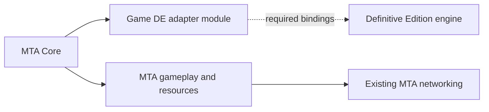

# MTA on Definitive Edition: reuse boundary

The October 13 user direction is to integrate the DE adapter into MTA. MTA owns
startup, input policy, gameplay, resources and networking. New backend work is
under `Client/game_de`, with Core consuming its SDK interface. The CLEO/UDP
experiment remains historical compatibility evidence.

The static-association SDK now has six partial DE read getters over the
original physical child row. The immutable index/locator does not reselect a
row when animation offsets change. WORD8/A/C/E retain their unsigned-node or
signed-ID/group/flags types. The actual hierarchy pointer is at18;10 is the
node-sequence pointer. Neither target is dereferenced or adopted by these
getters. Original parent/child cookies and owner bookends qualify each read,
without an added Created, node or hierarchy predicate. Initialization remains
pure, and no static-association factory is published.

The four source static-association scalar setters now forward their exact
WORD values through that same physical-row owner. ID, group and flags preserve
all signed-short bits. Node-count mutation is admitted only when both counts
are in the native signed-positive domain and the requested count does not grow
the freshly observed count; a positive current node range must also qualify.
Zero count needs no node dereference. This grants no node allocation, capacity
lease or free authority. A single guarded compare/exchange reports entry,
acceptance and verified completion, with full-row and ownership bookends.
After an entered failure the runtime stops; it never retries or rolls back into
storage that may have been retired and reused. Unsupported count growth or
high-bit counts refuse explicitly. These are the real low-level static setters,
distinct from the dynamic-association setters used during animation replacement.

The actual association-group SDK now has a partial DE implementation for
IsCreated, GetNumAnimations, GetGroupID, IsLoaded and the opaque GetInterface
tag. Every call re-admits its immutable generation/index/current-row reference.
Scalar reads preserve signed bits and require no block predicate. IsLoaded
uses the source's null-block false branch or the qualified native bank byte,
independently of Created. Unsupported initialization, copy, creation and static
association operations remain pure; no group factory or SDK-base deletion is
introduced. These current borrows grant no native mutation or lifetime lease.

MTA's SA and DE animation-ID checks now share the original enum gate and
signed-short ID comparison. The DE path preserves the real IsValidGroup
precheck, then observes only the selected native row's ID. The saved selector
subtracts the parent's DWORD offset modulo32 and zero-extends that index into
the original32-byte child allocation; its cookie supplies physical extent.
Out-of-cookie, torn or unowned reads refuse. No first-row/other-group fallback,
logical-count selector clamp, block-loaded, node or hierarchy filter is added.
No static-association facade, allocation or native lifetime is adopted.

MTA's actual SA and DE managers now share the original animation-group enum
gate. Invalid IDs return false before acquiring native state. The admitted DE
query reads the actual group's DWORD NumAnims and preserves the source's
nonzero predicate; an association pointer is not a Created heuristic. The
current native array comes from the qualified global and original allocation
cookie, with32-byte row bounds and owner/generation bookends. Saved publication
and shutdown code prove its cookie layout, retirement and global clearing.
This copies a boolean during the callback and owns no group, child allocation,
freeing right or lifetime lease. HasAnimGroupLoaded remains unimplemented.

MTA's descriptor block-name getter and first-group lookup now retain the saved
FF1070 behavior. Block-name borrowing uses the current descriptor at offset16;
first-group lookup searches the original fixed118-row prefix and returns the
first match or118. The definition count does not replace that fixed search
domain. The entire caller query is copied before callbacks, and native owner
allocation failure refuses explicitly. Current profile, exact row/name span,
source fold policy and searched-prefix bookends qualify results. These are
borrowed names and scalar IDs, with no association factory or native mutation.

MTA's association-definition count and group-name getters now use separate
current native observations backed by the saved named0245 evidence. The count
preserves its original signed32 scalar, independently of the positive table
extent required by name lookup. Group IDs retain their full32-bit domain;
count, exact row, name-through-NUL and owner are rechecked before borrowing the
native string. The safety bound is the actual56-byte descriptor span, with no
invented16-byte name field. No association object, table mutation or lifetime
lease is created, and the existing animation/block count channel is unchanged.

MTA's unsigned animation lookup within a block now keeps the source method's
hash semantics, despite its old `uiIndex` parameter name. The same native owner
searches the current qualified bank range for the first matching DWORD hash.
It reobserves the complete searched prefix and block/name/range/extent before
publishing a match or null miss. An unloaded flag alone does not erase this
lookup's current-range result, and zero count reads no hierarchy cell. Returned
facades borrow the qualified bank identity; no virtual raw getter, client row
stride, native allocation or ownership adoption is involved. Name lookup reuses MTA's existing source-exact ASCII uppercase key policy,
then calls the same hash overload without a native name cache or artificial
16/64-byte limit. Unrelated methods remain genuinely unimplemented.

Both existing MTA cache-removal overloads now reach the qualified DE private
hierarchy service. Typed dispatch copies the actual same-provider facade's
immutable identity; raw dispatch first resolves a current issued private row.
Only the already-proven zero-cache domain is admitted, including its original
linked array/frame epoch. Bank, foreign, stale and nonzero-cache observations
cannot grant cache ownership. Observed foreign cache state stays retained even
if its visible cell later clears; no cache splice, frame free or new binding is
invented. The manager remains partial.

Raw custom-sequence lookup now borrows either an actual owned array row or an
explicit Standalone record through a qualified physical identity. The client
uses no row-stride arithmetic. Raw standalone deletion now preserves SA's
interface-only behavior: the original metadata free ACK releases source-held
claims, while frame allocations remain independent or held by other arrays.
It neither frees frames nor reports typed full cleanup. Pending, foreign,
published and unknown records refuse, and capacity one grants no standalone
deletion authority. The raw locator ABI still makes no stale-address ABA promise.

MTA's integer animation lookup and raw bank-hierarchy wrapper now use the
existing DE bank reader. Ordinal arithmetic selects a request; repeated current
row, owning-block, range and highwater observations qualify the result. This
preserves the reader's current-range behavior when the block loaded flag is
false. Private allocations cannot become bank products. Returned facades borrow
the same provider, reacquire their native observations and own no native row,
frame or deletion right. These channels do not implement association factories.

Standalone sequence construction now has three required owner operations:
original-frame attachment, source cleanup and Copy transfer. The actual common
parser retains their CPU tickets across interrupted construction. TransferTo
requires an explicit SourceTransferred receipt; Reset can also consume the same
command's SourceReleased receipt after a provably unentered Copy cancellation.
Pending frame assignment keeps a separate ticket while source cleanup joins
its owner. Pointer equality and another native getter no longer decide who may
free accepted frame data.

DE issues the Standalone role through its actual allocation owner; a raw row or
capacity of one cannot create it. Factory facade memory is reserved before
native allocation, and operation facades adopt accepted views even after a
late refusal. The same existing journal, active callback pump and teardown
gates retain historical frame obligations and completed CPU views. Classic SA
shares original frame identities between sequence operations and hierarchy
cleanup. Raw interface-only deletion uses the metadata-only owner path described
above; mapping it to frame cleanup would change MTA's source behavior. These paths
do not advertise a complete manager, full parser exposure or CGame readiness.

Animation cleanup now stays with its backend through a required ticket.
Classic SA reserves its owner journal before exposing a hierarchy, gathers
the original full-capacity rows before effects, and remembers each returned
release. DE records CPU-only intent, claims the actual array/frame records
before matching parent detach, and preserves shared per-resource receipts.
Qualified callbacks continue accepted work after the caller drops its ticket.
Known holder waits preserve unrelated IFPs; unknown entered frees never replay.

Common animations clear their fields only on an explicit completed disposition.
Pending native work and completed live tickets retain backend code. Off-thread
terminal ticket drops retain code conservatively. Core preflights cleanup
before dependent teardown; GameSA closes its creator before deleting services,
and module quarantine survives automatic member destruction. This classic
shutdown path does not claim support for returning to active GTA after Core
unloads. Standalone sequence lifetime and complete parser exposure remain gated.

MTA's current fresh `SetKeyFrames` construction now selects the existing
compressed or uncompressed owner builder. It preserves full counts and the
original buffer owner, with explicit refusal for repeated, null or foreign
requests. This covers the actual common `AttachFrames` and `SequenceOwner`
path without inventing the original general setter's removed condition.

Four manager methods create, borrow and delete private hierarchy facades or
return a row facade from the original owned array. All providers must belong
to the same backend owner. Hierarchy resolution excludes bank adoption;
row resolution qualifies the original cookie, full capacity and heap without
reading child-zero metadata. A legitimate DWORD out-of-range result remains
distinct from owner failure. CPU allocation failure cleans a newly created
hierarchy through its real owner, while cloning failure preserves existing
resources. The manager is still partial, and parser exposure remains gated on
the remaining standalone sequence lifetime and complete manager boundaries.

The same private frame builder also accepts the saved loader's separate
uncompressed representation: 20 bytes per child frame and 32 per root frame.
It qualifies the original live frame allocation and full-width extent before
narrowing the stored count. Accepted format, count and root layout belong to
the actual allocation owner. Physical flags alone cannot create this authority.
Initialize clears it; Copy transfers it only with the exact copied snapshot;
frame retirement invalidates every referring descriptor before record reuse.

Quaternion repair and total-time calculation use the saved DE helpers only
through that typed owner. Positive sequence counts require the matching
attached parent command, actual held array and qualified uncompressed frame
records. The signed native count domains and full frame spans are checked
before entry. Empty receivers use the helpers' own empty branches. An entered
failure keeps its effects and blocks replay; acknowledged cleanup can still
detach the known private edge. This completes the facade's method surface,
while manager completeness and engine publication remain separate requirements.

MTA's cache removal and sequence removal now have qualified empty domains.
A current private hierarchy with a zero cache link needs no cache operation;
linked observations borrow the actual held array epoch. An empty, unlinked
receiver can clear its sequence pointer, count and total time, preserving the
hash, compression, block ID, padding and allocation journals. Pending parent
commands and nonempty receivers refuse this path. Accepted stores survive a
failed postflight acknowledgement without replay or rollback.

This implements the source's empty branches without entering a native cache
or heap routine. Nonempty child disposal still requires its own acknowledged
resource cleanup protocol. These empty branches do not provide that protocol.

Private hierarchy count and pointer setters now use a durable parent command.
The full WORD count remains independent of array capacity. Attachment holds
the actual array and frame records before writing the pointer; linked reads
borrow that same qualified array. Accepted writes resume acknowledgement
without repeating stores. Only the child owner's final release receipt clears
the command, and a null request detaches its matching private edge while
preserving the source count. Linked initialization is refused.

The runtime co-owns both controllers. Retirement follows sequence-then-parent
lock order within one shared gate and retains foreign/publication uncertainty.
These operations grant no engine publication or complete MTA startup.

The actual IFP parser now populates rows through their original owned array
before attaching that array to its hierarchy. The SDK requires an owned-array
row factory, with a real SA implementation using its existing cookie and row
layout. Cleanup gathers the full owned capacity even when parsing failed
before attachment, preserving initialized dummy rows and retained replacements.

The DE controller reserves prepared-array and frame-record dependencies
before parent operations. Held resources cannot be freed or have their
frame pointers replaced; row frame spans are checked against the real owned
buffer. A borrowed epoch shares one native gate. Callback success supplies no
parent acknowledgement; the physical parent protocol supplies its own durable
receipt. Complete manager integration remains separate work. The SDK addition requires
rebuilt source consumers.

Hierarchy naming now uses the addressed classic `SetName` body: ASCII name
normalization followed by the existing raw key generator. Its input has no
sequence-row 64-byte limit, and high bytes remain unchanged. Only the hierarchy
hash DWORD is written. Accepted writes define the hash even if a later owner
acknowledgement fails; initialization preserves both the hash and its defined
state. Other native bytes and publication retention remain intact.

The existing hierarchy facade now forwards MTA's compression and block-ID
setters to the same private owner. They write only the compression byte or
signed block DWORD, preserving every other native byte and hash definedness.
Inputs are copied before callbacks, with no added block-ID range filter.
Accepted stores survive failed acknowledgement without replay or rollback;
foreign publication retention remains permanent.

Private hierarchy creation and initialization reuse MTA's plain interface
allocation policy and its existing hierarchy getters. The DE receiver has a
40-byte native view; initialization clears the proved fields while preserving
the undefined hash and alignment bytes. Reading the unknown name hash refuses
that field without hiding valid time, block, count or interface observations.

These records share the existing callback generation and cleanup debt group.
Only a known empty receiver that has never been published can be deleted;
unknown children, cache links or publication intent retain its owner. This
receiver uses plain CPU deletion after the private parent protocol detaches
its known edge. It supplies no native destructor or complete parser cleanup.
The common parser now delegates that progress to its backend cleanup ticket.

An explicit private builder now prepares fresh compressed sequence frames on
the same allocation owner. It requires a fresh row, the exact original owned
frame base and a checked full-width count times the 10/16-byte compressed
stride. Only after the real buffer extent passes does the stored native count
narrow to WORD. It sets the proved rotation/root/compression fields and keeps
name, bone, unrelated bytes and both allocation journals intact.

The builder does not infer shared-memory bit08 from a supplied pointer, read
or initialize payload, allocate/free buffers, or publish to the engine. It is
used by the SDK only for qualified fresh construction. The original general
replacement/compression condition remains unresolved, and those domains
refuse. Entered failure retains cleanup authority and prevents replay.

Private sequence naming preserves raw NUL-terminated spelling within the
native 64-byte field; overlong names are refused without truncation. The
logical hash uses classic ASCII-only normalization and the existing raw key
generator, independent of DE's CRT locale. Only the name prefix through its
terminator is stored; unused native name bytes, flags and frame fields remain
intact. If the bone selector is active, the source union's new low WORD is
also projected into DE's separate physical bone field.

This operation uses the existing private allocation journal and shared row
state. It does not run the association initializer, name matcher, fallback
name-pool machinery or a cache update. Accepted stores remain acknowledged
after a later refusal, with no replay or rollback. General frame assignment
outside the qualified fresh domain refuses; naming does not complete a public
custom factory or native publication.

The native-bank hierarchy facade supplies the nine existing read operations
through the current callback owner. Scalar snapshots preserve raw hash, WORD
count, compressed byte, signed block ID and float representation. `IsCustom`
uses the actual block-ID comparison; a refused borrow does not become false.

Sequence-pointer reads use a separate channel over the genuine current
parent, native array cookie and checked private span. The full allocation
capacity remains independent of the logical WORD count, and indexed borrows
retain the SDK's full DWORD index. These observations grant no child lifetime
or free authority. The shared origin guard also serves the existing gateway
hash reader while preserving its two DWORD payload observations. Hierarchy
mutation and complete factories remain separate requirements.

The actual DE sequence facade implements qualified initialization, bone-tag,
property-copy and scalar/frame observations through the existing allocation
owner. A row token keeps the original array tag, full-width index and owner
generation. Per-row logical union state belongs to that array record, so
different facades observe the same state. Fresh initialization defines only
the low WORD; an undefined full hash is refused rather than filled from DE's
separate native name or fabricated upper bytes.

Bone assignment retains the full signed input until the original `-1` no-op
check, then narrows other values to the native WORD and sets the proved bone
selector. Sequence-row capacity and frame-buffer byte size remain different
quantities. A nonnull frame observation needs a live issued buffer with the
same generation and original heap, followed by a coherent final row read.

Whole-property copying transfers the complete 80-byte backend record and its
logical union between current private rows. It keeps overwritten and aliased
frame journals; a self-copy uses no overlapping memory store. A completed raw
copy stays acknowledged after a later refusal and is never replayed or undone.
Frame views preserve the full `size_t` index and `uint32_t` stride, including
zero stride, and qualify the requested span through the exact current frame
allocation without reading payload or imposing a narrowed row-count limit.

The facade remains abstract. General frame assignment still needs its
actual native contract; custom factories and hierarchy publication are
separate work. Private row
operations preserve the allocation journals and do not detach a published
hierarchy or reinterpret a C++ wrapper's destruction as native retirement.

The gateway animation query now reuses MTA's original equality policy and
existing uppercase key generator. The SDK asks the current owner for the raw
hierarchy hash; an observed mismatch returns false, while a refused observation
remains an error. It does not intern a name, invoke the native name cache or
construct a hierarchy facade.

The DE reader accepts only an aligned row in the actual hierarchy image bank,
within the current highwater mark and its owning block's current range. Two
coherent observations fence the raw hash with row, range, image and callback
ownership checks. Native unload preserves those hash and range fields, so the
hash-only query needs no loaded flag or C-string predicate. It grants no lease
over sequence/cache children and accepts no arbitrary custom allocation.

The actual animation manager's integer reference methods now keep MTA's
original distinction: `GetNumRefsToAnimBlock` promotes a signed 16-bit value,
while `CAnimBlock::GetRefs` exposes the same bits as unsigned. Manager AddRef
increments the native WORD; removal without deletion decrements it
unconditionally, including `0 -> 65535`. It does not load or unload a block.

Those integer operations use a separate current counter identity/read/write
channel. The complete raw 16-byte name supplies row affinity without a string
operation. Existing named block factories and getters keep their C-string
guards. Both paths use the same native bank, current callback generation and
one conditional WORD write, with no replay or count rewind after lost
acknowledgement. Destructive removal remains separate; the saved IFP unload
loop is an internal fragment, not a standalone block-index call target.

The native animation owner also supplies MTA's existing keyframe allocation
and free methods. They share the sequence array transaction, qualified heap
and runtime journal, with an explicit resource kind to reject the wrong free
route. Frame buffers return the original allocation base, have no array
prefix, and leave payload bytes to MTA's parser. The complete `uint32_t` byte
request is preserved. A null native allocation remains MTA's ordinary soft
failure only after owner/heap acknowledgement; it does not become a successful
buffer or an unacknowledged native effect.

Both array and frame resources use the same callback-generation, End and
module-retirement gates. The actual four manager SDK methods dispatch through
that same owner. Complete hierarchy/sequence factories and their engine
publication/retirement still require their own implementation.

DE's custom sequence array service now uses the genuine current native heap
to allocate `80 * capacity + 8` bytes and initialize every capacity row. Its
storage-only free uses the original allocation base and preserves independent
frame ownership. The actual animation-manager SDK delegates through an
explicit service on the same complete native owner, including zero/null
requests and current callback-generation checks.

The existing runtime owns each allocation journal before entering GTA. Known
unpublished allocations survive failed output acknowledgement and can retire
on the original cleanup callback. A returned free is consumed before any
fallible acknowledgement; unknown entered effects are never replayed. End,
new startup, callback removal and module retirement retain that journal until
its resources are discharged. Published arrays are conservatively pinned;
there is no generic detach or raw-pointer adoption operation. Actual hierarchy
attachment and complete custom sequence factories remain separate requirements.

Custom IFP sequence storage belongs to the animation backend. The common
manager now has an explicit allocation/free pair: it returns the first opaque
sequence tag, initializes every capacity row and owns its row size, alignment
and array prefix. Logical hierarchy counts stay separate from allocation
capacity. The classic implementation reuses its actual sequence declarations
and initialization policy; storage release does not free keyframes.

The existing MTA IFP parser now uses that storage contract for ANPK, ANP2 and
ANP3. It keeps bone mapping, dummy frames and frame conversion in common code.
A new load is prepared separately and published only after success, so a bad
read cannot replace an existing shared animation set. Temporary sequences own
their interfaces and frames until transfer; duplicate bones and failed reads
release their old owners. Cleanup uses initialized capacity, distinguishes
shared chunk bases from interior slices and calls the same backend that made
the allocation. Byte/count checks are local to IFP; the shared file reader
only adds an observation of its loaded byte count.

Hierarchy and sequence SDK facades also have appended virtual destructors for
their existing `std::unique_ptr<Base>` owners. These destroy CPU wrappers only.
The common hierarchy time getter may report a refused DE borrow by exception;
the existing classic override keeps its stronger `noexcept` raw read. SDK
consumers must be rebuilt together; old binary compatibility is not assumed.

The saved DE loader and complete cleanup/postprocessing bodies establish its
40-byte hierarchies, 80-byte sequence rows, eight-byte allocation prefix and
compressed/uncompressed frame layouts. Calculating total time also converts
absolute frame timestamps to deltas, so it requires one genuine call without
automatic replay after a lost acknowledgement. These proofs do not complete
the DE sequence factories or authorize adopting arbitrary raw allocations.

The animation block facade now supplies its genuine opaque interface and
hierarchy borrows. The legacy SA-named forward tags do not assert SA data
layout: common clients pass them back into the same backend. Current native
name/index/generation checks qualify the row; a loaded hierarchy also needs
the proved 40-byte row, owning block and current range. Unloaded blocks return
null before hierarchy index arithmetic, including a full-width `SIZE_MAX`.

Name, integer and opaque-address block factories create ordinary CPU facades
over those existing rows. They require matching native providers and an
explicit borrowed game for the existing request itinerary. They acquire no
native references or storage. Fresh opaque lookup issues a current receiver;
an old issued receiver keeps its expired generation. Remaining animation
manager and game providers still require their actual implementations.

`CAnimBlock` also needs a virtual destructor for the SDK's existing
`std::unique_ptr<CAnimBlock>` ownership. The declaration is appended after the
existing virtual operations; SDK consumers must be rebuilt together. CPU
destruction releases only the facade and never removes animation references.
This shared SDK change requires current classic/client compilation and ABI
checks; historical Core and gameplay evidence does not become a fresh build.

`CAnimBlockDE` now keeps MTA's actual inline `AddRef`/`GetRefs` policy on the
same source-proved native block reference WORD at `block+0x12`. The existing
name/index/callback-generation and game-thread/GC owner qualifies each borrow.
An increment makes one conditional 16-bit write, preserves unsigned wrap,
and accepts later native reference progress. Lost acknowledgement stops that
owner without retrying the increment or restoring the previous count.

Unloaded current blocks remain valid: MTA's shared request policy adds its
reference before loading. The focused integration checks that ordering with
the actual SDK methods and instrumented request/load boundaries. It does not
publish the missing game/model/streaming providers or manager removal
operations. The borrowed block factories and opaque hierarchy observations
are described above; neither grants native storage ownership.

`CPlayerPedMoveAnimDE` implements MTA's actual `GetMoveAnim` through the
registered native ped owner. It reads the current movement-group DWORD at
`ped+0x6e0`, preserves the signed 32-bit payload and applies the same `eMoveAnim`
cast as classic. `GetCustomMoveAnim` remains separate MTA-owned bookkeeping.
`SetMoveAnim` stays pure until its actual block-reference policy, loaded
movement associations, native reapply call and anti-override hooks are
qualified together; the getter adds no movement or animation writes.

The clothes-initialization prerequisite also follows actual MTA ownership.
The caller owns an unattached `NativeClothesDescriptorStorage` with an exact
`0xe8`-byte descriptor prefix. The existing native owner qualifies the current
GT/GC/world and name-cache context, then calls genuine `10390b0(descriptor)`
once. Native code initializes the descriptor and owns the accepted shared
name-cache effects. A pre-entry refusal may retry; an entered failure cannot
replay and stops the owning runtime. The unattached CPU object remains safe
for its ordinary owner to destroy because the initializer does not publish
its address. This adds no descriptor allocation or free through the native
heap, native player-data attachment, remote-player lifetime or complete
`CGame`/pool factory.
The next borrowed ped layer keeps MTA's actual `RebuildPlayer` operation
separate from clothing descriptor edits. The supported local CJ path uses the
genuine DE whole rebuild entry and its one native ped argument. Classic's
additional `false` argument is not an extra DE ABI parameter; the DE entry
reads the current native fat/muscle stats itself.

The existing registered owner qualifies the current local player, model and
loaded storage, clothing descriptor, render receiver, owned container and
reciprocal head relation before entering once. Native code owns retirement and
replacement of render objects, model references, tasks, stats and descriptor
copy effects. A fresh post-call receiver is expected; it must not be compared
for equality with the retired receiver. Entered failure stops the same owner
without replay or whole-object rollback. Remote stats swapping and full player
or renderer factories remain separate requirements.

The player-interface composition also supplies `GetWanted` from an explicitly
provided nullable CPU SDK association, matching MTA's initialized cached-pointer
getter. It neither resolves global player data nor owns or deletes that view.
The enclosing factory must choose and retain the correct association. This
does not infer a null value for legacy remote objects with an uninitialized
field, and does not grant a native wanted lease or complete player factory.

The DE ped service chain now shares a virtual `CPed` base, following the actual
classic `CPedSA` and common `CPlayerPed` inheritance. A player that combines the
existing DE services with MTA's player interface therefore has one ped identity
and one set of service state, rather than two incompatible ped subobjects.
This fixes the composition needed by a future player wrapper; it supplies no
missing player methods or complete factory by itself.

`CPedClothesDE` implements MTA's existing `SetClothesTextureAndModel` operation.
It preserves the original int-to-byte conversion and nullable texture/model
names. The native owner uses the existing registered ped and checked local
player identity, then calls the genuine DE clothes descriptor setter once.
A null clothes descriptor returns before reading names or checking the part.
For a present descriptor, the qualified native subset is parts 0 through 17
with bounded nullable ASCII names. Null and empty names remain distinct.
The native method owns its name-cache and descriptor changes; it does not
rebuild the player. Entered failures stop the same owner without replay or
whole-object rollback.

The local-player restriction is deliberate: the verified native constructor
uses the global player-data row. It does not qualify MTA's separate remote
player-data, clothes or controller ownership. Those genuine factory operations
and full game startup remain unfinished, and the installed trial is unchanged.

The actual `CClientPed::GetTargetedEntity` path now resolves an already common
ped wrapper through `CPools::GetPedClientEntity`. Player targeting already
selects the same pool's canonical wrapper; its current client association can
therefore be read directly without exposing a classic native interface. The
outer player check, single target query, lazy pool lookup for present targets
and existing non-ped fallback retain their original order. `GetStoredPointer`
is separate bookkeeping and is not used for this association.

This change uses the existing classic registry and the controlled DE registry.
It neither creates a new registry nor supplies the missing target-entity or
complete-game factory. The unchanged native backend remains historical tested
evidence; this batch validates actual common-client compilation and dispatch.

The borrowed ped layer now implements MTA's actual `CPed::ClearWeapon`
operation. It snapshots the existing registered token and forwards the original
weapon type to one genuine DE native call. This operation does not require a
complete SDK weapon-wrapper bank or substitute `CWeapon::Remove` for ped logic.

Admission follows the native branches: a missing standard slot or mismatching
row remains a native no-op; matching rows admit the model-reference storage
that will be decremented. Unequipping uses the genuine existing native entry,
with attachment prerequisites only on its actual branches. No model request,
streaming-loaded condition for a decrement, or CPU reference-count clamp is
added. Native code owns slot, model, actor and goggles changes. Entered failures
stop the existing owner without replay or rollback; complete factories remain
separate requirements.

The abstract camera layer now exposes MTA's actual const
`CCamera::IsSphereVisible` method, used by `CClientMarker::IsOnScreen`. It reuses
the genuine camera sphere predicate already qualified for the ped screen query,
without the ped radius, model or center-resolution stages. The backend copies
the caller's center before callbacks, preserves radius bits, and enters the
native predicate once through the current camera/world/thread/GC owner.

Native camera matrix, planes and depth may legitimately advance during that
operation; the adapter does not freeze them or calculate a substitute frustum.
Only a completed result publishes its boolean, including a successful false
result. An entered fault stops the owner without replay. Other camera methods,
render-model ownership and the complete camera/game factories remain required.

MTA's authored gateway animation names are now shared by the actual classic
animation manager and its DE SDK layer through `CAnimGatewayNames`. This
reuses the exact `ped` and `run_wuzi` literals; observing those CPU constants
does not require a native animation table or supply a hierarchy factory.

`CWorldIgnoreEntityDE` implements shooter exclusion for current registered peds
through the existing controlled `CPoolsDE` registry. It copies a qualified token
without exposing a classic native interface or creating another registry. Null
requests explicitly clear the owned filter; unsupported entity kinds remain
unavailable. The DE sector consumer compares a genuine pointer-sized ignored
entity global, so the adapter uses a guarded pointer compare/exchange rather
than changing collision policy or reproducing line-of-sight logic.

One runtime journal covers committed and uncertain pending pointer effects.
Matching reference release and runtime End must acknowledge the filter's
absence before retiring its registered cell. Cleanup clears only an owned
candidate and preserves a foreign replacement; a stable foreign value proves
our debt absent without proving the whole filter is null. Explicit SDK clear
still refuses that foreign state. Unreadable or uncertain cleanup retains the
existing reference and runtime debt for retry. No native auto-clear behavior or
complete entity factory is assumed.

The firing batch shares the actual `CWeaponSA::FireBullet` itinerary with
abstract `CWeaponFireBulletDE`. Its supported weapon set, shooter exclusion,
fresh pre/post handler reads, stat lookup after the pre callback, transformed
muzzle, native argument aliases, audio and final ignore reset retain their
existing order. The policy preserves accepted effect prefixes on exceptions;
it does not add rollback or turn a false native result into a failed itinerary.

`CGameDE` exposes a storage-free view of its existing handler registrations to
that layer. The common setters remain the only registration store, including
replacement, clearing and per-game isolation. Actual native `FireInstantHit`,
world exclusion, transformed bone and player audio remain required backend
services. The qualified world-static `06BC` bullet operation has a different
receiver, ABI and result, so it cannot substitute for the SDK weapon method.

The October 23 weapon-grant batch shares the actual `CPedSA::GiveWeapon`
sequence with abstract `CPedGiveWeaponDE`: weapon-info lookup, typed blocking
model request and custom-model preparation, satchel/detonator recursion, one
native grant, then lookup of the existing wrapper for the returned slot. It
preserves raw ammo, nullable preparation branches and exception prefixes. Giving
a weapon does not implicitly equip it. Both `GetWeapon` overloads and complete
model services remain required dependencies; this supplies no wrapper factory.

The DE grant enters the genuine qualified engine operation through the current
registered ped and the existing weapon-info reader. Current game-thread/world,
GC and preloaded model admission precede entry. Native code owns slot selection,
ammo handling, old-model release, attachments and goggles effects. Postflight
rechecks stable receiver and world authority while accepting those legitimate
changes. A failed entered prefix stops its owner without retry or rollback.
These offline checks do not publish a complete weapon bank or full MTA startup.

The October 22 startup work reuses MTA's task-wrapper selection, ordered
registry retirement and model request/reference sequencing in shared SDK
policies consumed by the actual classic callers. DE observes the native ped
Intelligence, embedded task manager and task bank through the existing engine
owner. Its abstract `CTaskManagerDE` implements secondary-task removal for the
qualified native subset, without publishing persistent task wrappers.

The abstract `CStreamingDE` implements MTA's existing `RequestModel` and
`HasModelLoaded` dispatch, including its separate vehicle-upgrade interval.
Upgrade requests enter DE's genuine paired-model operation once; their loaded
query checks the selected model and its configured companion. File requests
also use DE's genuine entry for all seven non-DFF categories, with their current
typed source/cache/buffer and intrusive-list prerequisites. List sentinels are
excluded from requests. Acceptance preserves asynchronous effects and does not
imply loading finished. Raw loaded observations cover the initializer's complete
streaming-row extent, including its sentinels; these facts do not publish SDK
model objects or RenderWare data.

Ordinary requests, upgrades and immediate reference adjustments share the same
native root/provider/model checks and callback owner. Reference changes reacquire
a keyed map row each time and use one conditional DWORD update. Missing entries
use DE's genuine reserve/publish helpers and initialized allocator. Upgrade
references affect only their selected key, preserving MTA's existing reference
semantics. Interior adjustments still refuse overflow, underflow and zero.
An explicit final-release operation admits exactly one to zero, preserving the
occupied keyed row. Its caller chooses whether to keep the model resident or
remove it using actual custom-resource eligibility; native fields cannot supply
MTA's custom-clump/collision policy. Removal requires complete admission before
the count changes and another current-owner check at native entry. Accepted
effects persist on later failure without rollback or replay. This does not
grant a retained model lease or complete MTA's `ModelAddRef`/`RemoveRef` wrapper.

`CStreamingDE::RequestSpecialModel` enters DE's genuine existing-slot rename and
requeue operation. The qualified subset requires an existing non-upgrade DFF
slot, zero native interface references, supported removal state and an ASCII
name of at most eight bytes. It preserves the full channel/flags value. Current
world, heap and initialized FName/cache admission precede that single entry;
the game owns hashing, name storage, cache growth, removal and asynchronous
requests. Its copied input stays alive through the native call and is not
retained afterward. Failed entered effects are not undone or replayed. This
does not create missing metadata or implement `MakePedModel`.

The abstract `CModelInfoRequestDE` now reuses that same request/reference policy
for the actual SDK methods. It owns MTA's wrapper DWORD reference and pending
counters, borrows the real game's async/streaming receivers, and preserves
request flags, retry order, pending acknowledgement and exception prefixes.
`GetRefCount` returns the wrapper counter. Native interface increments and
custom-aware removal remain mandatory backend effects; DE's separate sparse
DWORD map is not a classic metadata ushort reference field. Usable render data,
model dependencies and blocking-load reporting also remain explicit required
operations, so this layer does not publish a model factory.

`CAnimBlockDE` implements the existing animation-block index, loaded flag,
animation offset and count methods using DE's actual named block bank. Its
copied index/name identity belongs to one runtime generation; reads recheck
the native row and current callback before publishing values. An old wrapper
cannot borrow a later runtime, and a refused read does not stop an unrelated
current owner. The native DWORD animation count widens to the SDK's `size_t`
without changing its bits. The observation bound is not an allocation capacity.

`CAnimBlockRequestDE` and the real classic `CAnimBlockSA::Request` share MTA's
original loaded short circuit, unsigned IFP model arithmetic, nullable model
lookup, request flags, reference increment and blocking load order. Release
builds preserve the original removal of assertion observations. Native
`AddRef`, hierarchy/raw interfaces and the complete animation factory remain
required work; request sequencing supplies no substitute native reference
counter or render object.

`CAnimBlockDE::GetName` returns the actual mutable inline name address in DE's
validated image bank. The copied index/name/generation identity is checked
again at publication; a changed identity preserves the caller's output and
refuses the read. This is a current-callback borrow, with no copied writable
name, reference lease or guarantee that the text stays unchanged. A native
name edit invalidates later reads through the old copied identity.

The abstract `CAnimManagerDE` reads the game's signed animation and block
counters and implements `GetAnimationBlockIndex` with the genuine first-match
name-folding rules. It snapshots the current native names, preserves the real
missing-name result of `-1`, and refuses lost ownership rather than reporting
an absent block. Its lookup budget is separate from native capacity. These
observations create no blocks, animation hierarchies or reference ownership.

`CStreamingDE::LoadAllRequestedModels(false)` enters DE's genuine all-model
flush with a current typed game-mode/world context. Priority loading uses the
current priority flags and qualified native pending handles, then the game's
own wait and completion callbacks. Unresolved requests without those handles
refuse instead of silently flushing unrelated work. Both paths share the same
recursion guard; lost acknowledgement preserves effects and stops the owner.

`CStreamingDE::LoadScene` uses the genuine named scene-loading entry and the
same loading guard. Admission checks the current world, persistent level,
typed GTA world settings and their native scene target. Adapter model and
upgrade requests also use that guard, keeping nested requests from borrowing
a loading operation's live admission; native internal requests remain part of
the game's own operation. Entered scene effects survive failure without replay.
The native collision-request command only marks requests asynchronously and
does not establish MTA's separate synchronous `LoadSceneCollision` contract.
Streaming memory bytes and the classic paired-buffer protocol also remain
unmapped; model counts and provider extents cannot stand in for those services.

`CWorldGroundDE::FindGroundZFor3DPosition` enters DE's genuine scalar ground
query through that same loaded-world owner and native-call serialization gate.
It copies MTA's XYZ intent and returns the accepted native height, including
the native zero result for a miss; refusal raises a service error. Current
sector and matrix-list readiness are checked around the call. The engine owns
its scan-ID wrapping and lazy matrix allocation, so valid list transitions
remain accepted. Entered failure preserves those effects and stops the owner
without rollback or replay. The remaining world SDK methods and complete
`GetWorld` factory stay separate prerequisites.

`CWorldLineDE::IsLineOfSightClear` reuses that whole native query admission
and the existing MTA flags. It owns both endpoint copies, passes the seven
flags consumed by DE's native clear query in their original order, and returns
the native boolean directly. Shoot-through and car-tire flags remain unused,
matching the classic MTA implementation. A blocked ray is a successful false
result; owner refusal raises a service error. Native scan and lazy matrix
effects retain the same one-entry, no-replay behavior as the ground query.

The adjacent `CWorldAreaDE::GetCurrentArea` preserves MTA's raw DWORD area
contract through a guarded native data read on the same current loaded owner.
Its global area value is independent of the per-ped byte area. It does not
enter an engine function or require the ground query's matrix-list state.
The read publishes all 32 bits only after its ownership bookends agree;
refusal leaves the caller's output untouched and never supplies a default area.

MTA's aircraft height, velocity and squared velocity now share
`CAircraftLimitsPolicy`. The classic multiplayer implementation owns the same
three-float state, initializes it at the original constructor point, and binds
its six native consumer operands to that state. Raw float and velocity-product
semantics stay in this shared policy. DE consumer bindings remain separate
prerequisites; copying these values alone does not control DE aircraft.

`CWorldJetpackHeightDE::GetJetpackMaxHeight` reads the native scalar actually
consumed by DE's jetpack thrust calculation through the current world owner.
The qualified value resides in read-only data shared with native code. The
getter preserves its accepted bits without a constant fallback. The setter
remains unimplemented until an isolated native consumer binding is qualified;
the shared read-only literal is never treated as writable game state.

Ordinary `RemoveModel` uses DE's genuine removal entry for the qualified idle
and loaded-model branches, including current streaming links and asset owners.
The direct streaming operation leaves the separate model reference untouched;
explicit final release composes the two only under the caller's chosen policy.
Archive, memory and scene operations still keep the streaming service abstract.

The abstract `CModelInfoDE` supplies the actual SDK's model key, type and named
boat/car/plane/helicopter predicates. Named predicates use genuine native
classifier entries. Type reads share a bounded reader for complete native
constant-return functions, without invoking an arbitrary virtual method.
`IsVehicle` keeps MTA's archive-allocation prerequisite using DE's genuine
named `IS_MODEL_IN_CDIMAGE` predicate: a current nonnull bank word with native
missing-archive flag 80 clear. This observes archive membership rather than
inventing classic physical block sizes or using loaded state as a substitute.
These observations publish no model factory, retained lease or render object.
The native loaded flag, provider bundle and typed weak asset do not establish
MTA's second DFF render-readiness gate. The qualified native instancing factory
can return null and mutates ownership, so it cannot substitute for a pure query.

MTA's four loaded ped/vehicle group getters now read DE's actual 24 ped slots,
raw ped count and 50 aggregate vehicle slots. Shared selection rules preserve
MTA's signed-value filtering and vehicle terminator behavior. These group facts
grant no native model lifetime. Refused noexcept SDK queries fail explicitly;
they cannot silently report empty groups or absent archives.

`CGameDE::GetGameVersion` identifies DE as version 30 while preserving every
classic version value and the existing join-packet byte layout. Core already
separates DE startup from its classic downgrade check. This identity does not
make the still-abstract game interface or x64 networking ready.

The shared pool interface now returns MTA's common `CPed`, `CVehicle` and
`CObject` links. Classic uses the same registry rows and registration/deletion
policy with those types; actual callers use the existing SDK methods. DE does
not need a parallel registry or a cast between differently typed row layouts.
This removes a classic-only SDK dependency without completing native pool or
ped factories.

The abstract `CPoolsDE` reuses that registry policy for qualified existing DE
ped wrappers. Controlled registrations borrow the wrapper's immutable token
from the same native owner and withdraw the CPU row before wrapper destruction;
the existing controller continues to own native reference cells. Lookup first
checks genuine native presence, then the registered wrapper/token identity.
Qualified missing handles can return null; missing callback authority remains
an explicit refusal. Fabricated nonnegative handles with the empty-slot bit
set are unsupported and refuse instead of claiming the native helper returned
null; signed-negative handles keep its proved early-null behavior.
Counts, count-only reset and local-client invalidation
remain MTA bookkeeping. Construction/deletion factories and `GetPools`
publication are still separate work.

`CPools::GetPedClientEntity` resolves an existing common ped wrapper through
that same registry. The actual post-shot, damage, death and bullet-impact
callbacks use it at their original lookup points, preserving current client
reassociation, local invalidation and event ordering. They no longer need a
classic native-interface roundtrip for a wrapper already supplied by MTA.
Sparse slots are searched independently of the resettable registration count;
the separate `GetStoredPointer` field is not an association fallback. DE checks
its controlled row, native token and current owner before returning the client,
and preserves explicit refusals. This adds no registry or native ped factory.

`CPedBorrowedFactoryDE<ConcretePed>` now provides the enclosing lifetime for a
complete, caller-supplied DE SDK wrapper. It acquires through the existing native
reference controller, checks the exact token and owner, then registers the typed
wrapper in the same pool. Explicit retirement withdraws the SDK row before typed
destruction and one native release attempt. A mutable row that still names the
wrapper delays destruction; an entered release failure stays with the controller
for its existing cleanup. The destructor cannot retry native work. This seam
does not supply missing ped virtuals or allocate/delete a native ped.

Garage initialization also shares MTA's ordered sixteen-entry policy between
the actual classic manager and the abstract DE manager. The unused classic
garage-interface accessor stays on `CGarageSA`, outside the shared SDK, so
modules must be rebuilt together. Numeric garage identity and the DE manager's
`GetGarage` factory remain separate prerequisites.

Named garage type/open access uses the genuine bank's first matching name and
rechecks its published count and selected row around each operation. The SDK
slice shares MTA's door-state policy with classic and preserves independent
byte stores; DE script commands have additional transition effects. All four
geometry getters now copy one coherent fourteen-word snapshot, preserving raw
float bits and MTA's existing upper-Z value for `GetSize`'s height output. The
named class implements all eight SDK properties with controlled construction.
Classic numeric-ID mapping remains unqualified, so this does not expose a
complete garage manager.

Bounded native loader proofs now establish the genuine `grge` parser's append
call and the order of `IPL` directives within one DAT input. The packaged record's
integer columns supply flags and type. Outer startup file order, initial bank
state and classic numeric garage identities remain unqualified; these findings
do not supply a numeric garage factory or permit the sixteen default writes.

These batches have offline primitive, actual SDK/callback-owner and normal
build coverage. The changed classic callers compile through their normal
project. The installed GTA candidate remains separate from this newer source;
complete `CPed`, `CPools`, streaming, the `CGame` factory and x64 networking
still gate full MTA startup and playability.

The October 21 native weapon backend now supplies the complete existing
`CWeaponInfo` interface through eighty stable SDK objects. `CGameDE` uses MTA's
shared weapon/skill selection and the existing engine callback owner to obtain
these objects. Scalar setters, native slot selection and fire-offset updates
write the qualified DE bank; the fire-offset getter preserves MTA's borrowed
native vector contract. Interrupted vector updates retain their exact component
journal until an admitted callback can retire owned changes, preserving later
engine edits. This completes the weapon-info object rather than the still
abstract `CGame`, native ped/weapon gameplay objects or network client. Offline
fixtures and the normal backend build remain distinct from live GTA validation;
the previously installed candidate stays available for the deferred combined
test. The port remains experimental.

The native weather extension reuses that same callback owner for eight scalar
override groups. Constrained allocation placement preserves displacement bytes
outside the selected aligned 64-bit word, admitting all thirty-seven direct writers
without a partial instruction write or a 128-bit CPU requirement. Actual
allocation bases and interior accumulator addresses have distinct retained
identities. Reset restores native progression without rewinding an accepted
scalar value. Rain additionally owns its directional archive entry and lifetime.
The complete `CWeatherOverridesDE` object is borrowed through admitted
`CGameDE::GetWeather`; it does not complete the enclosing `CGame`. Separately, actual `CStats`
reads now use the qualified DE float/integer banks and weapon-skill classifier.
The complete four-method `CStatsDE` also delegates Set/Modify to the qualified
native reaction transactions through this same runtime. `CGameDE::GetStats`
publishes its stable SDK object; writes require actual playing state, loaded
player identity and the native setter's additional script prerequisite. An
entered failure preserves any native effects and stops the lease without
replaying the transaction or restoring a guessed bank snapshot. These native
calls are implemented and checked offline; live validation remains separate.

`CGameDE::StartGame` now forwards MTA's existing SDK request to the actual named
DE frontend/loading action. A separate internal startup mode uses the existing
normal post-original game-mode frame hook, generation and retirement machinery.
The public application-frame observer remains read-only. The admitted call
checks the native initialized GameThread identity, scoped GC marker, current
typed owner/world/providers, configured transition classes and immediate UObject
registry identities. Its final entry claim consumes one attempt per generation;
missing prerequisites consume none. The real action performs frontend teardown
and requests asynchronous loading. Return does not certify a loaded world, and
an entered failure preserves native effects without replay or a state8 shortcut.
This extends the partial backend; the complete `CGame` factory, native gameplay
objects and x64 network module still remain prerequisites for full MTA startup.

The retained startup owner now observes the native loading pump after that
generation's real request was entered and published. The native state, pending
request and pump latch must all match the freshly admitted application receiver;
an opaque identity comparison ties these observations to the original request.
State9/request0/pump0 can predate a new request, so those values alone supply no
transaction history. The observation reports native pump retirement and leaves
MTA's existing loaded-session checks responsible for player/network readiness.

The abstract `CWeaponNativeDE` implements MTA's type, state and independent
clip/total-ammo accessors on the genuine thirteen-slot native ped weapon array.
The shared context rechecks the selected slot and raw type, and one mutation
guard covers all four DWORD fields. These operations preserve raw MTA storage;
the script ammo clamp and coupled initialization effects are not substituted.
Typed getters refuse values outside the SDK enum's language range before
conversion, without changing global enum declarations or claiming gameplay
ranges. `CWeaponPolicyDE` preserves the explicit borrowed CPU ped/slot pair.

`GetInfo` reuses MTA's existing selector and the qualified runtime weapon-info
bank, with current type and registered-token bookends. A legitimate missing
selection returns null; lost ownership or an unavailable bank remains an
explicit failure. The wrapper is still abstract: standalone allocation,
initialization, removal, firing and native reload timing remain separate work.

`CPedWeaponSelectionDE` reads the genuine current-slot byte through the same
registered ped owner. Its typed SDK getter checks enum representability before
conversion and never indexes the weapon array. `CWeaponPolicyDE` also preserves
MTA's null-guarded `SetAsCurrentWeapon` delegation to its borrowed ped. Native
slot changes remain separate: the engine operation removes and creates model
attachments, so a raw slot store cannot stand in for that lifecycle.

The abstract `CPedWeaponStatsDE` extends that same chain with MTA's current
weapon-stat and range methods. Classic and DE share the context check and lazy
weapon, skill and manager lookup order, including both fresh `GetStats` calls.
The DE wrapper explicitly borrows its enclosing `CGame`; native service refusal
propagates. Only an actual null stat yields MTA's existing range value of 1.0.
This does not allocate a weapon or complete the remaining ped factory methods.

`CPedTasksDE` similarly reuses MTA's actual gang-driveby query policy. Stored
intelligence availability is checked before the virtual getter; the query
then reads the primary task and its type once. A missing task returns false,
while service errors propagate. The real intelligence wrapper, availability
hook and task-manager implementation remain mandatory factory dependencies;
this composition does not fabricate native task ownership or query another
priority as a substitute.

`CPedGogglesDE` adds MTA's const `IsWearingGoggles` predicate to that borrowed
chain. It observes only the native goggles-object association, independently
identified by the named removal command, its direct clearing routine and the
common ped constructor. Two coherent snapshots and the retained owner's
registered-ped checks precede publication. No target object is dereferenced or
exported; vision effects, removal and the remaining ped factory are separate
dependencies. An unavailable owner raises the existing service failure rather
than silently reporting that the ped has no goggles.

`CPedVisibilityDE` implements MTA's raw `IsVisible` and `SetVisible` property
through that same registered owner. The named DE visibility command and common
entity constructor identify its flag independently. Reads require coherent
snapshots; writes use one masked conditional update and preserve every other
flag. The script command's separate current-player global is excluded from
these SDK methods. Owner loss preserves output or accepted effects and follows
the existing retirement path without retry. This does not implement the other
rendering methods or complete the ped factory.

`CPedOnScreenDE` implements the inherited `CEntity::IsOnScreen` query through
the supported DE command's native radius, bound-center and camera-predicate
sequence. One serialized operation holds the current registered ped and world
owner, calls each genuine component once, and keeps its intermediate values
local. The final native boolean is published only after the ped, model and
world bookends still agree. Native lazy geometry effects remain owned by the
engine; entered failure stops the owner without rollback or replay. The wider
ped factory and separate `IsFullyVisible` method remain prerequisites.

MTA's `CreateWeaponStat` factory also shares its existing defaults and flag
transition policy between classic and DE. The complete owned `CWeaponStat`
contains custom CPU data, as the classic unlisted factory does; its mutable
fire-offset vector belongs to that object. Classic manager originals remain
mutable and are looked up at each constrained flag transition. Custom weapon
execution separately uses the real native weapon-info bank.

The assembled `CGameDE::CreateWeaponStat` now uses the qualified manager's
unlisted factory, like classic MTA. Its caller owns the concrete CPU record and
must retire it before that manager; later constrained flag changes observe that
creating manager's mutable originals. This route neither registers a live stat
nor starts native default population. The earlier standalone partial factory
retains its separate immutable-default behavior.

The complete native `CWeaponStatNativeDE` borrows those same stable bank
objects and callback writer, including model/fire type, animation loops, aim
offset and default-combo fields. Flag changes reuse MTA's shared policy and
resolve mutable originals at each transition. Persistent writes preserve
accepted effects and later native edits if a subsequent operation loses its
lease. The combo-count setter preserves the exact native BYTE storage contract,
including the adjacent default-combo byte; this proves storage behavior rather
than a gameplay range. This differs from the complete owned CPU stat returned
by `CreateWeaponStat`.

The manager's existing first-match lookup, skill selection and deliberately
disabled list reset also share one SDK policy between classic and DE. The DE
manager owns 76 typed CPU originals in classic insertion order, including
duplicate standard records, and borrows live SDK identities through explicit
registration. Metadata edits and mutable originals remain observable; unlisted
CPU stats keep their original-provider lifetime contract. The complete
`CWeaponStatManagerDE` creates live wrappers only for exact identities from its
80-row bank and applies the shared MTA defaults after registration. Construction
creates CPU originals with no native I/O and leaves the live registry empty,
matching MTA's separate initialization step. The partial `CGameDE` now exposes
this runtime-owned manager through a qualified borrow without replaying defaults.
Classic startup and explicit DE live-stat population now consume one shared
80-row schedule, preserving MTA's different standard info/stat keys and exact
poor/professional/special ordering. DE population admits one explicit attempt
on an empty live registry; failure preserves its registered/native prefix and
refuses replay. The explicit constructor-preparation host now acknowledges one
complete row per natural application frame, waiting for that row's model and
animation prerequisites before native effects. It uses the same schedule and
manager, without renewing a callback lease or replaying completed rows. Entered
failure retains its effects and stops preparation; vector component debt stays
with its exact native callback owner for retirement.

Optional `BeginGameConstructorPreparationV1` and `ReadGameConstructorPreparationV1`
connect that host to the retained adapter and its existing clock cleanup owner.
Progress exposes counts and flags after actual admission, with producer and
generation checks. The existing startup observer remains read-only. The tagged
`CGameDE` constructor accepts only completed services from its exact clock; it
performs no initialization writes. Its completion callback can freshly read
prepared weapon services without acquiring timing or weapon write authority.
This prepares constructor services before MTA's separate later game initialization;
the complete `CGame` factory and remaining services are still unfinished.

A separate prepared constructor route captures the existing complete clock,
stats, player-info/wanted, ropes, weather and weapon services as one borrowed
identity bundle. It publishes only after the current playing-state owner and
all eighty weapon rows qualify, and records that owner's generation. This does
not strengthen the earlier weapon-only frame contract into a gameplay lease.
Prepared getters recheck the captured generation and their selected service;
they do not re-read the whole weapon bank on each ordinary getter. These
borrowed objects must retire before the owner generation ends, and their raw
SDK pointers do not independently convey a native lease.

The complete `CAudioContainerFiles` implements MTA's three audio-file SDK
methods from an explicit archive root. Classic `CAudioContainerSA` delegates
to it using its existing relative `AUDIO` source. Lookup, RIFF/PCM and radio
extraction retain caller-owned buffers and report unavailable or malformed
input through the existing failure contract. Missing classic lookup data does
not introduce a constructor exception. Lookup readiness describes that file
only; it does not prove full archive compatibility. No DE archive root,
`GetAudioContainer` publication or native audio-engine capability is inferred.

Core's existing `CGameAdapterModule` now owns this optional preparation contract.
It resolves the begin/read exports together with their clock retirement functions
before admission, validates the shared MTA schedule's progress values, and retains
the exact producer token after a failed begin or end. Older providers remain usable
without these optional exports. Preparation is explicit and does not advertise a
complete `CGame` or start another native owner implicitly.

Classic and the abstract `CGameInitializationDE` also share MTA's separate later
initialization order: garages, special characters, broken models, renderer,
then native menu hiding. DE requires fresh readiness before effects and keeps
the missing native operations mandatory. Each explicit call preserves classic
reconnect behavior; exceptions propagate with their applied prefix. The typed
renderer initialization stays outside the common renderer interface. This does
not establish numeric garage mapping or publish a complete `CGame`.

The shared `CGameResetPolicy` preserves MTA's reconnect/reset itinerary too.
It gates effects on actual playing state, then retains fire cleanup, camera
restoration/fade, unpause, both existing HUD-disable calls, HUD visibility,
model/object defaults, world restoration and the conditional building-capacity
reset in their original order. The abstract `CGameResetDE` uses the common SDK
services and requires the remaining native restoration operations explicitly.
Repeated calls retain MTA's behavior; a failed effect propagates with its
already applied prefix, without replay or a successful placeholder.

`CGameWorldDE` shares MTA's world removal, restoration and building-pool resize
policy with the classic caller. It uses the common building/dummy pools and
commits the removed-state flag only after each complete native sequence. The
IPL restore filter compares the exact eight copied name bytes against
`barriers`. Active same-size requests retain remove/resize/restore, removed
same-size requests only drop caches, and a false resize result still restores
an active world. Oversize requests fail before native admission. Native IPL,
cover, plant, shadow and cache operations remain required backend effects;
this orchestration does not qualify those operations or complete `CGame`.

Their special-character and broken-model stages also consume the same ordered
44 named assignments and two collision substitutions. Classic retains its
direct model-array receiver and conditional collision-pointer copy. DE calls
the actual `CModelInfo::MakePedModel` on a mandatory qualified startup receiver;
the collision hook must preserve the conditional borrowed-pointer semantics.
The native IDE ped-metadata publisher has been identified, but its typed-row
construction, capacity, occupied-key retirement and collision ownership remain
unqualified. A special-model streaming request does not replace that creation
contract, and these stages cannot be overridden with whole-stage no-ops.

`CGameTimingDE::GetGravity` also reads the current qualified native downward
acceleration operand through the existing timing-reader binding. It preserves
finite binary32 values and refuses changed image/code/read prerequisites.
The separate oriented-force operand and unrelated sample/filter consumers
prevent treating this pooled constant as a mutable world-gravity property.
`SetGravity` remains pure until those consumers and override lifetime are
qualified independently.

MTA's nineteen world-cheat names and four set permissions now share one SDK
policy with the classic backend. The DE reader supplies fourteen independently
qualified native flags through the existing callback owner, preserving the
classic nonzero-byte read contract. Writes remain limited to the original four
properties. Five native identities remain unresolved, so full `ResetCheats`
and `PerformChecks` remain pure. The native all-cheats initializer also changes
time scale and weather; it cannot replace MTA's registered-row reset. Faster
clock reads reuse the clock owner's exact stock or owned freeze identity.

The existing callback owner also supplies all eighteen `CPlayerInfo` methods
and the complete three-method `CWanted` service. `CGameDE::GetPlayerInfo`
borrows the stable SDK object after fresh player/profile admission. Money
preserves signed balance and separate display state; instant updates publish
both together. Food, stamina and drunkenness retain their native field and
fade semantics. Wheel counters, heading, health/armor limits and drive-by
permission come from independently qualified producers and consumers. Wanted
changes call the real native reaction path; NoFlash restores only the attributed
timestamp, preserving other effects and later edits. Entered failures stop the
lease without replay or whole-object rollback. These are offline implementations,
with live validation still separate.

Native ped handles now resolve through the actual pool and slot-generation
bank. Handle1 means occupied slot0/generation1; it cannot substitute for the
current player in a restored save. Checked observations require the existing
callback owner and repeated root/header/slot identities. They grant no deferred
pointer lifetime, SDK ped wrapper, pool registration or full `CPools` service.
`GetPools`, `InitLocalPlayer`, the complete `CGame` factory and x64 networking
remain prerequisites for full MTA startup.

Classic `CPoolsSA` now consumes a shared MTA ped-registry policy for slot
registration, lookup, client reassociation and count maintenance. It preserves
replacement/count behavior, native resolver ordering, count-only reset and
clear-before-destruction ordering. The original `SClientEntity` declaration is
shared without a layout change. Native creation and deletion remain with the
classic caller. This policy does not publish a DE pool or fabricate wrappers
whose lifetime cannot yet be maintained across callbacks.

The existing callback owner now retains native ped reference cells behind
versioned CPU tokens. Registration supplies a stable pointer word to the real
native weak-reference list and verifies the resulting node before publishing
a token. Every later borrow checks that exact cell address, native list and
occupied ped identity again; the seven-bit pool generation alone supplies no
lifetime guarantee. Native destruction or bank reset invalidates borrowing
without turning an old handle into authority to repair a recycled ped.

Release consumes the token before cleanup. End retires a bounded number of
cells per natural callback and keeps hooks, admission and module ownership
while any native node still names their storage. An entered unlink failure
cannot be replayed; storage is released only after a fresh complete-bank check
proves the cell address absent under the same qualified owner generation.
This internal ownership path reuses MTA's pool slot policy and prepares the
wrapper lifetime boundary; it does not publish a partial `CPed` or `CPools`.

Token-based health and armour operations reuse that same native owner and the
occupied native ped identity. The qualified common ped constructor and generic
script route cover both known generic/player ped classes without a dependency
on the current-player root. These operations preserve the classic raw float
field behavior, including values outside normal gameplay ranges, without
changing the adjacent maximum-health field. Each store uses an exact-width
conditional exchange and rechecks both pool and registered-token identity.
An accepted value persists after End or failed acknowledgement; this raw
setter neither invokes resurrection nor rewinds later native effects. The
qualified subset comprises the two exact known ped vtables; complete SDK ped
publication still requires the remaining entity operations and wrapper wiring.

The abstract `CPedRotationDE` adds MTA's raw current-rotation getter/setter
through that same registered-ped owner. Native construction, the named heading
producer and current-facing control consumer qualify the radian field; the SDK
preserves raw binary32 values rather than wrapping script degrees or updating
the placement matrix. Each write changes only the current field and retains
accepted effects on later failure. The adjacent target field still lacks a
separate semantic mapping, so target rotation remains pure alongside native
physics repair and the other unfinished ped methods.

`CPedStateDE` extends that same SDK chain with raw oxygen and the genuine
ducking predicate. Oxygen requires the selected registered player ped's own
qualified inline player data; missing data, a different ped or a generic ped
cannot borrow whichever player is current. The current-player selector is not
used as a substitute. A single conditional breath-field write preserves raw
binary32 values, stamina and neighboring data, with accepted effects retained
on failed acknowledgement. Ducking uses the independently named native flag
for either supported ped class. Its raw SDK setter changes that bit with one
masked conditional store, preserving neighbors without retry or replay. Like
the classic setter, this property write does not create a crouch task or apply
an animation; accepted or uncertain effects persist after failed acknowledgement.

The SDK's `GetType()` instead reports MTA's CPU wrapper identity, used by its
pool ownership policy. The explicit constructor value and `SetType` bookkeeping
preserve the full DWORD even when native access is unavailable. This value is
neither the native ped category nor the entity-type field, and it does not
publish a concrete ped or prove a factory/destructor mapping.

`GetCustomMoveAnim()` likewise reads MTA's protected signed CPU bookkeeping,
with the existing zero initialization. Future animation producers must update
that bookkeeping after their own engine operation; this getter neither changes
native animations nor depends on a currently admitted native callback. Occupied
seat methods remain pure until the enclosing wrapper supplies explicit initial
seat state rather than borrowing an uninitialized classic value.

`CPedWaterDE` extends the same wrapper chain with `SetInWaterFlags`. Independent
native construction, buoyancy and query consumers qualify the submerged and
touching bits. One masked conditional write preserves every neighboring flag,
with accepted effects retained on failed acknowledgement by the existing token
owner. The distinct `IsInWater` getter follows MTA's primary-task predicate:
the existing immutable ped token admits a fresh intelligence/primary-2/task
observation, and the qualified water task has native type 268. A qualified null
or known non-water task returns false; an unknown class or changed owner refuses
the read rather than guessing from the physical flags. Native deletion can
precede manager-cell and pool-flag clearing, so this immediate observation does
not publish a task wrapper or lifetime lease. Recognizing 268 for reading also
does not expand secondary-task deletion: that path still explicitly admits
only the previously qualified 203 and 305 classes.

`CPedOrientationDE` forwards MTA's three original radians through that same
registered ped owner. The genuine DE route removes world membership, applies
native Euler orientation, then updates the actor/component and adds world
membership again. Every phase freshly qualifies the resulting graph; legitimate
list retirement and republication do not require stale list identities to stay
alive. Failed entered phases retain their effects and stop without replay or
compensating Add. Orientation shares the placement/Teleport reentry gate and
preserves the existing matrix-required Teleport route. It does not implement
arbitrary `SetMatrix`, target rotation or last-good physics repair.

`CPedAreaDE` implements the inherited raw area-code byte getter/setter on that
same registered ped. Independently named DE read/write commands identify its
storage, but MTA's setter does not include those commands' additional interior
cleanup. The backend preserves all 256 byte values and uses one conditional
byte store, including same-value requests, without changing neighbors or
retrying. Lost acknowledgement retains accepted effects; no interior streaming
or complete entity factory is supplied by this property.

`CPedFireDE` adds the actual const ped fire query by observing the associated
native fire pointer without following or exposing it. The inherited nonconst
entity query retains MTA's separate generic fallback through a policy shared
with the classic backend. Keeping that fallback in the earlier ped layer
preserves classic name hiding and dispatch through both SDK interfaces.
`SetOnFire` and native fire-object lifetime remain unimplemented.

`CPedCollisionDE` implements the existing entity collision-use setter on the
same registered ped. The named DE command, constructor and physical contact
consumer establish the flag's role. One masked conditional store preserves
neighbors and never retries; accepted or uncertain effects are not replayed.
This raw flag operation does not create a new getter, rebuild UE collision
components or publish a complete ped factory.

`CPedFlagsDE` adds MTA's existing vehicle shooting-permission and bike
knockoff accessors on that same registered lifetime. Independently named native
commands establish the masks; the neighboring `TestForShotInVehicle` property
remains unqualified. Bike writes preserve MTA's full-DWORD intent and its low
two-bit assignment, including stored value three, without claiming a gameplay
meaning for that value. Conditional masked writes preserve neighboring bits;
only an unaccepted neighbor-only conflict can retry, within a fixed bound.
Accepted effects survive failed acknowledgement without replay or rollback.

`CPedBehaviorDE` continues the same SDK chain with the named bleeding and
stay-in-same-place properties. Each setter owns its proved bit in the shared
native word and preserves the other property, ducking and every neighboring
flag. The stay property does not substitute either of the separate native task
commands. Both operations share the existing token, callback admission and
bounded conditional-write policy; they do not simulate blood or task behavior.

`CPedCombatDE` adds the actual fighting-style accessor pair. Classic and DE
share MTA's same-style early return and extra-move bit policy. The named DE
command establishes the native style/extra storage, but its reset behavior is
different and is not invoked. A changed style updates its byte and the eligible
extra bit while preserving both adjacent bytes and other extra bits; a same
style request adds nothing. This remains within the registered-ped owner and
its existing failure and retirement rules.

The abstract `CPedVitalsDE` SDK layer now implements MTA's actual `GetHealth`,
`SetHealth`, `GetArmor` and `SetArmor` virtual methods through that token-based
owner. It preserves raw float values and reports a refused native operation
without retrying it. Its constructor copies only CPU token identity; reference
acquisition and retirement remain with the future enclosing ped/pool owner.
The other inherited SDK methods remain pure, and this layer has no factory or
registry entry. It cannot yet be published as a usable `CPed`.

Read-only ped metadata also uses the registered-token owner. Qualified native
entity constructors, model producers/consumers and both ped destructor chains
establish the raw 16-bit model word and masked entity-type byte. Reading the
model word accepts `FFFF` and performs no model-bank lookup or validity claim.
The abstract `CPedMetadataDE` layer adds MTA's existing `GetModelIndex` and
`GetEntityType` methods to the four vitals methods, sharing one immutable token.
The other SDK methods stay pure; no registry or ped factory is published.

The abstract `CPedMutationDE` layer adds the existing raw `SetMoveSpeed` and
`SetTurnSpeed` SDK methods through that same registered token. Successful
components persist if a later reference acknowledgement fails; the owner stops
without replaying the request. The noexcept move-speed setter records its
result explicitly. Its stored-client-pointer methods preserve the existing
`CClientPed::_CreateLocalModel` association as per-instance CPU bookkeeping;
they neither acquire an engine lease nor take ownership of the client object.

Position, matrix and raw velocity observations also resolve the retained token
before and after the existing native readers. Refused or lost lifetimes preserve
caller outputs; a position borrow keeps the actual native vector address only
within that admitted callback. MTA's exact bounds, remembered position, lazy
fallback selection and single repair/re-read ordering now live in the shared
`CEntityPhysicsState`, consumed by the actual classic entity/physical getters.
The DE getter layer uses this same policy with a mandatory pure native repair
hook. Complete placement, world/actor refresh and collision reset must be
qualified before a concrete ped can supply that hook. Placement setters and
the classic teleport wrapper remain incomplete; no ped factory is published.

The same registered owner supplies the existing physical mass and turn-mass
SDK getters/setters. Independent native force and torque consumers establish
the fields and their raw units. Each scalar mutation touches one binary32
field, preserves neighbouring physics/vitals state, and retains an accepted
effect if acknowledgement fails. Optional borrowed-owner forwarding reaches
the shared getter layer; an absent owner explicitly refuses these methods.

Air resistance, elasticity and local-space centre of mass now use that same
physical owner and existing SDK methods. Native damping, contact impulse and
force/torque consumers establish their meanings independently of field layout.
Centre-of-mass writes retain exact accepted components if a later scalar CAS or
lifetime acknowledgement fails. Reads commit caller output only after their
registered lifetime survives. Buoyancy remains unqualified and unavailable.

Classic pool templates and the DE ped reader also share MTA's slot bounds
policy. Free-slot selection retains the classic cursor/probe order and does
not reserve a row or change its generation. Native allocation remains with
the engine; shared selection and bounds supply no entity lifetime guarantee.

The same native callback owner supplies immediate ped position, matrix and raw
velocity observations. Position borrows preserve the actual inline or owned
matrix vector address, with fresh pool-generation and matrix-owner checks.
Script velocity scaling and vehicle-coordinate substitution are not applied
to the entity itself. A borrow ends before another native operation can replace
or recycle placement. The native teleport operation changes world links and
velocities; it does not stand in for ordinary SDK `SetPosition`.

A distinct native teleport transaction is also implemented for the qualified
matrix-backed ped subset. It checks the actual GameThread, loaded world,
ped/matrix/intelligence identities and the native skeletal actor/component
ownership before entering the genuine ped teleport function once. Native task,
world-list and velocity effects belong to that operation. An entered failure
stops the existing owner and preserves those effects; it never replays the
intent or restores a guessed entity snapshot. This primitive publishes no
partial `CPed` object and does not complete the remaining entity SDK methods.

The abstract `CPedPoseDE` layer now implements the actual SDK `SetPosition`
overloads and `Teleport`. Classic `CEntitySA` and DE share the finite-input and
commit-order policy. DE placement writes only the qualified current position
components, refusing the classic train cases before any write. Matrix-backed
SDK teleport commits placement and last-good CPU position before entering the
existing native teleport operation once; inline placement skips that operation.
Placement and teleport share a reentry boundary. Partial or uncertain effects
remain with the existing token owner and stop its intent without rollback or
replay. Matrix/orientation repair and complete ped construction remain unfinished.

Raw linear and angular ped velocities also use the existing callback owner.
Both vectors retain native units and copy into caller storage. Setters check
the current occupied ped identity and update exact components conditionally;
accepted components remain if a later write or acknowledgement fails. The
receipt records confirmed effects, and an entered failure stops the owner
without retry or delayed repair under a recycled pool generation. Classic
nonfinite-value repair and object-only moving-list effects belong to separate
SDK policies; this narrow ped service does not fabricate a full `CPhysical`.

The complete two-method `CRopesDE` service reuses MTA's `CRopes` interface and
the existing native callback owner. Creation calls the genuine DE rope
registration path with the requested duration and native ID/counter semantics;
the native full-table return does not certify that a rope was created. Removal
treats the SDK entity argument as an opaque identity key and checks the actual
selected row's registered native references. Entered failures preserve effects
and stop the owner without replay or broad rollback. These services are checked
offline; live validation and complete game/pool startup remain separate.

Rain's shared runtime now retains its own near RX leaf, separate RW descriptor
and exact direct-writer/entry journals. Loads advance the real synchronous
archive through a temporary value, while saves retain native Rain reads. Stack
bounds come from independent NT_TIB/current-thread facts; unreadable, changed,
fiber or borrowed stacks refuse admission. The same parked peer set must pass
old/new continuation checks before either entry exchange and allocation release.
A bounded native enumeration rejects unexpected threads without a loader lookup
or growing collection under the hold; it supplies no future global thread-birth
lock. Partial operations retain exact code, protection, cache, handle and
allocation debt. The complete SDK implementation is checked offline; this does
not claim live weather or full MTA readiness.

The October 19 application-frame trial observed 277 natural gameplay frames
and both configured UI dictionary entries without engine writes, then retired
its hooks and unloaded Core normally. A combined startup observer now reuses
that same MTA worker and native lease for declared UI-class relations, the
enclosing game-mode/interface correlation and a conservative world link. Its
256-byte SDK record and 192-word report distinguish missing prerequisites,
wrong types and refused reads. Runtime `a089e0c7b` passed the combined gameplay
trial: all 65 frames confirmed both UI types and the owner/world links, with no
refused observations and complete native/Core cleanup. All 14 saved logs and
normal shutdown are pinned by
`Build/definitive-recovery/current-actual-startup-observation-checkpoint.json`.
This does not establish UObject lifetime, controller/UI provider readiness,
cold frontend readiness or permission to call native startup methods. Existing
networking remains MTA's responsibility.

The October 20 native-main-menu attempt with runtime `6f2d628ff` reached JS
entry and arming before CJ existed, but the activation chord produced no new
log event and never loaded Core or the Bridge. The user reported normal GTA
continuation. All fourteen raw logs, unchanged installed hashes and normal
shutdown are preserved separately in
`Build/definitive-recovery/current-startup-observation-frontend-attempt.json`.
This was an unstarted workload, not a failed native-frame observation. It does
not replace the successful gameplay certificate above. Startup observation
now uses frame yields and bounded chord-only receipts to distinguish script
resumption from key delivery at the frontend; the same MTA worker, native lease
and 192-word report remain in use. This scheduling change awaits a live check.

The native frontend entry now offers a path independent of that CLEO scheduling
boundary. Its explicit native package starts the existing retained Core worker
hidden from the pinned loader's `InitializeASI` callback, claims the same single
controller and uses the same mailbox, heartbeat and cleanup. A native thread
reads foreground activation chords; CLEO returns without claiming another owner.
The real Core retains localization, local command and console log services across
hidden periods, using shared normal-startup construction and rollback.

The combined October 20 GTA check on `f556dd92f` passed: hidden Core was ready
32 ms after the native controller started, before CLEO resumed; the first Show
command arrived 111.688 s after startup. Two actual menu views produced 179 and
298 presents and retired with restored input scopes and detached cursor hooks.
The user confirmed I movement/sprinting, I retained on reopening and ordinary
W/camera restoration after End. All 15 run logs and normal shutdown are saved
against the 14 existing-log baseline. The native-main-menu location is human
reported, rather than proved by these logs. The existing missing
`cgui/images/question.png` error reproduced. Expected process pinning can keep
`game_de.dll` mapped after its callbacks end. Native view gates still apply;
visible playerless GUI, full `CGame`, client and network readiness remain open.

The following offline update packages the four existing MTA message-box icons
as a complete optional group, producing 62-file frontends and 64-file native
packages while retaining historical ownership layouts. MTA's normal x64
launcher preflight and loader switch now admit native startup and those assets,
including INI/configuration agreement. This is package/launcher admission; it
neither replaces the real network module nor opens a full-client launch path.

The next startup batch adds explicit `--de-launch` to that same MTA launcher.
Preparation checks the registered Steam library, app 1547000, exact installed
native package and ownership receipt before MTA's existing shell helper can
request Steam startup. Preparation is independently testable without dispatch.
The request result deliberately remains separate from in-game Core readiness.

Native view admission now reuses the backend's checked game-state reader and
the same local-identity predicate used for movement. Known frontend/loading
or qualified ineligible states retain hidden Core without creating a view or
arming initial local input. Another explicit F9 can retry after context changes;
missing evidence and mutated owner reports still fail. No playerless GUI or
complete `CGame` is fabricated. The October 20 check on `8697e3f13` confirmed
actual MTA-to-Steam launch, hidden Core ready in 47 ms, a nonterminal first
Show and a later explicit GUI view with 65 frames/presents. That view restored
205/205 input scopes with zero failures and detached the cursor hook after
suppressing 197 engine warps. End unloaded Core/GUI/XML/pthread, and GTA exited
normally. The user reported all combined steps worked, but this session logged
two Show commands and only one actual GUI view; a separate reopening is not
claimed. The earlier two-view result remains separate. Raw logs, offsets,
current-PID/module evidence and normal shutdown are pinned by
`Build/definitive-recovery/current-actual-steam-startup-checkpoint.json`.

The standalone launcher also offers `--de-launch-installed`: Steam registration
and the appmanifest locate the game, and its adjacent native ownership receipt
provides the files to validate. It shares the existing game/PE/hash/config/INI
policy without constructing package provenance or requiring workspace paths.
The normal launcher build and both preparation modes passed 22 process cases,
15 VDF parser checks and 25 discovery/layout checks. Positive installed checks
call only the new preparation export; this selector has not dispatched Steam
in the offline batch. Core, backend, Bridge, GUI and all 64 installed files are
reused unchanged from the live-tested candidate.

The real Deathmatch client now builds and links for Release/x64 using MTA's
existing code. Engine work is assembling its actual `CGame` services:
`CClockDE`, the complete four-method `CKeyGenDE`, eight native timing getters,
and scale/game-speed/minute-duration/pause setters on the existing engine owner.
An internal timer continuation keeps pause restoration available while the
clock/weather path is skipped; the public clock V1 contract is unchanged.
Nine streaming-ID getters use verified DE operands and the full 26316-row count,
without exposing DE rows through classic structures. These new pause and
streaming paths have not yet been exercised through a live full `CGame`.
`GetSystemState` separately maps the proved native frontend/loading/gameplay
states through a checked reader. Early native states 0–5 and lifecycle writes
remain unsupported; native indices are never blindly cast into the SDK enum.
`IsAtMenu` observes both the typed SA menu-widget owner and legacy frontend
screens. It keeps their read qualification separate from native lifecycle calls;
no widget is dereferenced and matching snapshots do not claim an engine lock.
`CGameDE` supplies real clock/keygen accessors but remains abstract until the
other subsystems exist. The exported factory therefore still supplies no full
game interface, and client startup/networking remain incomplete.

The existing asynchronous model-loading policy is now shared by classic and
DE through `Shared/sdk/CAsyncLoadingPolicy.h`. DE's three actual `CGame`
methods reuse MTA's script override, temporary suspension and strict deadline
rules; their timer remains independent of paused game time. These methods
control MTA scheduling, not native streaming rows or model-request lifetime.
The policy and DE clock wrapper passed 65 checks on each of x86 and x64, and
the changed classic `CGameSA` translation unit compiled from the normal project.

Retained frontend owners also have an explicit movement-binding persistence
opt-in. `MTA_EnableDEFrontendBindingPersistenceV1` uses MTA's user-data directory;
the `AtPathV1` variant supports an explicitly owned host path. Both reuse the
existing frontend handle, owner-thread admission, XML factory and `CKeyBinds`.
Only the six supported movement controls are written to
`definitive/keybinds.xml`; the installed `coreconfig.xml` stays unchanged.
Settings stages a separate manager, commits the generated file atomically,
then swaps in the staged manager. A failed save leaves the prior file and
bindings active, and Cancel discards edits. Existing diagnostic/session APIs
remain session-only unless their retained owner explicitly opts in. This
feature does not start GTA, networking or a second configuration lifecycle.
The retained runtime now exposes the matching owner-level
`MTA_EnableDEFrontendRuntimeBindingPersistenceV1` / `AtPathV1` calls so the worker
can load bindings while hidden, before GUI or local input borrows them. The
additive Bridge start `DE_LocalInputRuntimeStartPersistentV1` and package option
`-MtaCoreFrontendRuntime -MtaCoreFrontendBindingPersistence` select that path.
Legacy starts preserve session-only semantics. Missing or refused persistence
APIs stop and clean up the requested runtime instead of quietly losing Apply.

The DE clock service now implements MTA's existing five-method `CClock`
interface behind an optional Core-owned adapter contract. Commands cross a
mailbox to the exact-image native continuation after clock progression; Core
does not write engine time from its worker thread. After mutation, the bounded
lease restores captured displayed time and fractional-minute phase without
rewinding the native timer. A read-only session instead retires using verified
current values, allowing natural progression without clock writes. Clock
transactions exclude native input/render ownership and retain failed patch,
protection, data or thread-resume cleanup for retry.
This is one service toward the real `CGame` implementation. It does not expose
a partial `CGame` or enable gameplay capabilities. Read-only live behavior and
the later bounded single-Set recipe are established for their separate runtimes
below; live freezing remains untested.

The first live candidate is the separate Smoke opt-in
`-MtaCoreClockReference`, using the existing Core startup worker and optional
`CClock` provider. It owns only the base 23 files and excludes every GUI,
rendering, input and other trial. It submits Read commands only, with no GUI,
NPC, network connection, player-input write or game-time write. The F9 arming
gate waits indefinitely, then requires release before the ten-second readiness
window and up to ten seconds of observation. Generation-bound acknowledgements
and advancing native time are workload proof; safe retirement is a separate
requirement before Core unload. Ordinary mode changes clear the opt-in, while
intact historical configurations without its declaration require an update to
enable it.

The October 18 runtime `d9de393a1078deb12432bcdd984357eefb60b261` passed its
actual Read trial: **198 acknowledged Reads**, **608 qualified callbacks**,
**200 timer-progress observations** and **10,000 ms** of workload. The user
reported normal GTA continuation. Independent validation covered all 88 logged
samples with **5,033 protocol checks** plus **51 metadata/layout checks**.
Native ownership retired and Core/GUI/XML/pthread unloaded. Normal exit kept
all fourteen live log prefixes and 23 installed hashes exact, with only 74 new
CLEO shutdown bytes. The machine exit code is unknown; saved shutdown markers,
process absence and the human report supply the qualified normal-exit proof.
The source cohort was frozen before later changes and sealed with the raw
recording at `Build/definitive-recovery/current-actual-clock-read-checkpoint.json`.

The separate trial, `-MtaCoreClockSetReference`, keeps base 23-file
Smoke ownership and reuses the optional `CClock` provider for controlled
Set/Read commands and native restoration. Its default-false
`MTA_CORE_CLOCK_SET_REFERENCE` flag excludes the completed Read flag and all
input/render/GUI trials. The distinct mode18 / API1 / 128-field Bridge/Core
report preserves Read's mode17 / 96-field contract; no new MJS module or
separate game lifecycle is introduced. GUI, NPC, network and player-input
operations are outside this candidate. Its offline validation passed the
normal Core/Game DE build, 710 native checks, 670 Set lifecycle checks per
x86/x64 architecture, 125 worker cases, 1,202 script checks and the
980-check Set package matrix.

Runtime `f749e634f1b8227123bb035a0868d4e614d620fa` passed this recipe in GTA on
October 18: from an initial producer Read of **19:11:53**, it issued **one Set
to 12:15**, acknowledged after **62 ms**, then completed **97 subsequent Reads /
98 total Read acknowledgements** through **12:19:43**. The **5,000 ms** workload
recorded **305 qualified callbacks** and **101 timer-progress observations**.
The user reported normal GTA continuation and a visible time change. All
**45 saved samples** passed **3,348 independent checks**.

End restored the provider's captured **19:11:48** and fractional phase. The
earlier provider capture and later producer Read are distinct observations;
their equality is not part of the restoration proof. Native hooks, commands,
peer holds and recovery debt retired, and Core/GUI/XML/pthread were absent from
the final module snapshot. Normal exit passed **159 checks**, preserving all
fourteen log prefixes and 23 installed hashes; only CLEO added its 74 shutdown
bytes. The OS exit code remains unknown, separately from the human normal-exit
report, process absence and ordered shutdown/Exit markers. The new evidence
pointer is `Build/definitive-recovery/current-actual-clock-set-checkpoint.json`;
the earlier Read and Settings evidence remains separate.

Live Freeze, Unfreeze and ResetTimeFrozen remain untested. This bounded result
does not unlock full MTA gameplay or networking, and the port remains
EXPERIMENTAL.

Visible GUI integration continues inside Core using the existing CGUI/CEGUI
renderer. The new opt-in surface attaches an MTA-owned transparent child window
to GTA's validated window and uses the retained D3D12 device with its own queue
and composition swapchain. Native observation ends before GUI or window work.
This provides a bounded visible-output trial while native backbuffer rendering
remains gated on safe resize/destruction handling. It does not replace MTA's
GUI, unlock full startup or establish multiplayer readiness. Actual on-screen
output must be verified separately from readback and compositor submission.

Current checkpoint: actual MTA Core owns saved XML configuration, its existing
`CKeyBinds`, adapter pulse and digital synthesis on the startup worker. Its
corrected scoped-write session passed **30,009 ms**, **595 native samples and
259 script snapshots** with forward, isolated forward walk, isolated forward
sprint and neutral coverage. All **1,801 applications restored**, with
**61,299 routed queries** and zero native failures; the human reported normal
walking and actual sprinting. Both canonical frames ended neutral, Core/XML
unloaded, the backend PIN matched and all 23 hashes passed. Normal exit passed
with the complete 99,637-byte shutdown log. This establishes
bounded local forward input through MTA, while full gameplay/render/network
capabilities stay gated and the port stays EXPERIMENTAL.

Core's existing module-loading sequence lives in `CreateStartupModules`.
Both classic renderer paths delegate to it, preserving
Network/Game/Multiplayer/XML/GUI order, the early reentrancy flag and existing
failure handling. DE admission now precedes the flag and every classic module
load, including direct calls to that method. The full startup rejection stays
in place until the remaining systems are ported.

Core's DE `CreateGame` now requests a borrowed `CGame` facade from its selected
adapter. The accessor requires the owning thread, an explicit capability and
a nonnull facade, preserving output on rejection. Core records the ownership
and leaves teardown to the adapter's successful Shutdown/Release sequence.
Classic factory/version checks and Terminate behavior remain on the classic
path. The production DE adapter still exposes no facade; opaque fixture
pointers verify lease policy without pretending to implement CGame.

The opt-in x64 MTA launcher also has a headless file preflight through its
existing loader dispatch. It verifies the supported executable and a coherent
23-file owned bundle without starting GTA or loading Core. Its valid result
explicitly leaves launch readiness and full MTA readiness false. See the
[preflight contract](../launch/DefinitivePreflight/README.md).

The active native renderer is now observed through actual Core on D3D12.
The latest ten-second API4 trial recorded 606 native callback entries and 603
accepted scalar snapshots. All 87 logged snapshots contain complete GPU
metadata and recognize the pinned Gameface native custom presenter. The
human reported normal GTA continuation; cleanup, all 23 installed hashes
and normal exit passed. The read-only probe still rejects GPU ownership:
603 rejected probes, zero accepted. Presenter identity does not establish
the resource state, final queue ordering or a safe drawing boundary.

The optional render factories preserve adapter ABI6 and older observation
ABIs. Core ends each lease before adapter teardown and retains ownership on
detach or final-readback failure. API1/2 copy scalars without COM calls;
API3/4 query and release callback-local COM references without issuing GPU
commands. The source flags remain disabled by default, with indefinite
manual F9 arming before each bounded trial.

The API5 observer reuses the same Core owner and worker. It scopes
the standard DXGI Present entry to the pinned native caller, after the Social
Club callback, and copies 110 scalar fields. Exact swapchain/backbuffer/queue
association, CPU tracker values and resize/destruction counters are separate
from GPU ownership: even a coherent association cannot authorize drawing.
Native endpoint and detour ownership checks refuse changed code and retain
the module when cleanup cannot finish. The completed trial continued normally
and passed cleanup/normal exit, but all 87 samples refused endpoint admission;
no standard Present or backbuffer association was observed. A separate optional
20-scalar diagnostic now reports the preparation gate and module-relative
slot/branch categories to the same Core worker. The completed diagnostic
identifies a loaded-code hash mismatch: the expected DXGI Present entry was
already patched with an E9 branch to private executable memory before MTA's
hook installation. The native swapchain slot still equals DXGI RVA `0x19000`.
The relay's memory category does not identify its owning DLL. Core logs those
values under the explicit DE root; the next native integration must preserve
the existing Present chain. It changes no observation wire or drawing guard.
No GUI assets, input writes or GPU commands are included.

API6 keeps that result intact and appends a separate native dispatch record.
Its source-pinned callsite intercept forwards the existing swapchain slot
target, so a pre-existing DXGI patch need not be replaced or trusted as MTA's
own code. Core owns the same typed adapter lease and worker lifecycle; the
bridge transports 136 scalars through a distinct opt-in version. Profile2
describes native dispatch and CPU object association, while API5's profile1
still describes an admitted system DXGI entry. Neither grants GPU ownership.
Offline publication/rollback checks and normal MTA builds pass. The latest
primary-backbuffer API6 trial recorded 603 native callbacks, 601 accepted
snapshots and 601 native dispatches with no association rejection. All 87
logged samples contain coherent profile 2 association, complete queries,
`S_OK` probe and forwarded results, and matching native/DXGI buffer indices.
Ten fresh roots reports completed their after-Close readback. Cleanup, all
23 installed hashes and normal exit passed, preserving the full 46,055-byte
capture plus 74 shutdown bytes and unchanged diagnostic logs. This validates
native CPU/COM association. GPU ownership remains unsupported with zero
accepted probes, and the system DXGI API5 endpoint remains unadmitted.
No GPU commands, drawing or full client readiness are established.

The preceding roots-diagnostic API6 trial installed hooks after three stable passes with 187 initial/peak
holds. It recorded 606 native callbacks, 601 accepted scalar snapshots and 87
complete metadata/known-presenter reports. Native dispatch intercepted and
forwarded 601 calls, but all association queries refused at `NativeRoots` with
probe `E_POINTER`; forwarded target results were `S_OK`. All 11 fresh roots
reports identify a successful selected-texture read followed by `RequiredNull`
at checkpoint 22. The selector branch, primary slot value and underlying cause
remain unknown; unsampled queries and earlier trials have no new cause claim.
Cleanup, all 23 installed hashes and normal exit passed, preserving
46,824 captured bytes plus 74 shutdown bytes and unchanged diagnostic logs.
This proves bounded interception, not admitted buffers or GPU drawing.

The narrow correction removes an extra command-data dereference exposed
by pinned native instructions. Its owned full-graph regression fails on the
old reader and passes after the fix; 3,650 native checks plus four
unavailable-build checks pass. MTA still owns the Core worker, typed adapter lease and cleanup;
the native correction supplies no separate client or rendering bypass. Its
live result still refused. A separate 14-scalar read/refusal diagnostic uses the same MTA
lease and worker. It preserves all existing reads, guards and the 136-scalar
observation, publishes only accepted-callback cache values and logs outside
the callback. Its strict reader binds fresh PID/run/generation evidence;
diagnostic success cannot admit buffers, GPU commands or full startup. The
next correction follows the primary `viewport+0xA8` backbuffer used by native
resource preparation, rather than requiring its nullable format-dependent
alternate. Existing selector/coherence, canonical buffer identity, resource
state and cleanup guards remain; the subsequent trial validates that corrected
association without changing the GPU ownership gate.

The preceding API6 attempt returned HookInstall with zero callbacks. Its setup
report identifies `StableLimit` (stage 21), no OS error, 189 initial/peak holds
and four discovery passes entered. No transaction or hook write began; cleanup
and normal exit passed. The exact limit branch, object identity, liveness and
cause remain unknown. The next correction passes 3,617 native checks plus four
unavailable-build checks. Bounded continuation uses a disjoint VM-backed cache
of exact exited objects: first sightings reset stability, repeats require fresh
exit proof and pinned native identity comparison. The four-pass limit and two
consecutive stable passes remain. Standalone owned proofs pass 27 continuation
and 34 identity checks without establishing the actual game's limit cause.

The preceding API6 attempt also returned HookInstall with zero callbacks. Its separate
setup report identifies `StableSuspend`/Win32 access denied (5), before any
transaction or hook write. All 190 initial holds were released; cleanup and
normal exit passed. The failed thread's liveness is unknown. An owned 350-check
Windows test reproduces the same error for exited and live restricted threads.
The correction passes 3,483 native checks plus four unavailable-build checks. It
skips only a proven exited handle and restarts bounded discovery; live or unknown
threads still refuse. Retained exited objects can still reach the four-pass
limit safely. Complete owned install/detach coverage includes shared-page
protection and suspension-count restoration.
The earlier strict DXGI mismatch is tolerated during preparation.

The GUI backend reuses MTA's actual CGUI/CEGUI widgets, skins, fonts and
textures. Owned offscreen WARP tests cover BGRA8, RGBA8 and the observed
R10G10B10A2_UNORM target, including pending-frame retention and teardown.
Those tests do not establish visible GTA rendering, HDR or color-space
correctness. Those earlier tests ran without installing GUI assets into GTA.
An additive asset-root export now configures cgui independently of Core,
avoiding classic folder discovery when both DLLs live beside the DE bridge.
The actual `Win64/CLEO/de-online` layout passes 510 offscreen D3D12 checks
across the three formats; the existing D3D9 path passes 93 checks.
Owned swapchain tests now pass 777 checks against real three-buffer DXGI
swapchains in formats 24/87/28, including fence retention, two resizes per
format and shutdown without another frame. The Core GUI helper passes 103
checks for actual CGUI rendering, fresh asset/log paths, pending fences,
signal recovery and irreversible release faults. Debug-layer validation was
unavailable; these tests do not claim it.

The first actual-device startup trial passed. It adds an explicit one-shot retained
device handoff. Ordinary API6 observers retain no device and keep the existing
136-scalar contract. Core preloads the existing cgui assets, requests the new
lease, and detaches the observer before creating its own queue and fixed BGRA8
offscreen target. It reuses the actual MTA widgets and verifies fenced pixel
readback. Separate Core11 / GUI API1 reports contain 64 scalars, with native
association, owned GPU work and cleanup checked independently. Pending drains
retain all owners; unknown release faults never authorize an unload.

`package.ps1 -Mode Smoke -MtaCoreGuiStartupReference` explicitly selects this
36-file trial; the ordinary package remains 23 files and the source flag stays
false. The completed test renders offscreen with no visible overlay or
movement. The existing 23-file launcher preflight is separate and does not
validate the GUI bundle.

The live trial completed in 401 ms on Core and 523 ms on the script. One
coherent profile-2 device lease produced the actual 640x480 BGRA8 GUI workload:
two helper clear/copy submissions, one CGUI frame, fence 1/1 and 133,058 changed
pixels with background/texture/alpha checks. Core/cgui/XML/pthread unloaded,
the backend PIN matched, all 36 installed hashes passed, and normal GTA exit
preserved the 6,580-byte capture plus 74 shutdown bytes. The 219-byte Core GUI
log is unchanged. This establishes actual-device offscreen GUI rendering;
native frame drawing, full startup and multiplayer remain gated.

The next visible integration must preserve the existing renderer and establish
a new native/Core ownership contract. `IGuiD3D12Session::RenderFrame` already
records barriers, submits work and signals its supplied queue. The existing
API6 facts and one-shot device lease grant no authority for those operations on
the native queue or backbuffer. Admission needs a source-pinned boundary after
native rendering and the Social Club callback, before the actual Present, with
the required resource state and submission order established independently.
Same-queue ordering alone does not establish where native work is submitted.
See Microsoft's [submission contract](https://learn.microsoft.com/en-us/windows/win32/api/d3d12/nf-d3d12-id3d12commandqueue-executecommandlists).

The pinned profile-2 seam already sits after the custom-present/Social Club
callback and immediately before the vtable `+0x40` dispatch. The existing
`HookNativeDispatch` preserves the captured target and forwards it once.
Static native paths place final barriers and queue submission before the
wrapper; API6 now confirms the selected context/manager/queue/device and current
`GetBuffer` identity. The separately pinned native `CreateSwapChain` path
establishes the creation-queue relation; `GetDevice` supplies device identity.
The CPU tracker value is still intent, not a GPU state read. A new explicit
write lease must declare its state/order policy;
inferring the valid game's PRESENT contract must stay explicit.

Core should prepare cgui and register a retained callback owner on its worker,
then create/use the real session and widgets on the authorized render thread.
The current offscreen helper stays worker-owned and continues to end observation
before starting GPU work. Full `CCore` frame pulses remain gated because their
gameplay dependencies are not initialized by this diagnostic startup.

The native producer must also coordinate pause, resize/destruction and stop:

- Deliver only a validated frame with strong device/creation-queue/current-buffer
  references and explicit generation, resize epoch, index, format, dimensions
  and resource-state/submission policy. Reject foreign or nested delivery.
- Stop admission before resize, drain GUI work on its owner thread, and release
  every external backbuffer reference before forwarding the native operation.
  Revalidate afterward and recreate the session on device/queue/format changes.
  Current resize/destruction hooks count and immediately forward, so they do
  not provide this handshake. See the [DXGI resize requirements](https://learn.microsoft.com/en-us/windows/win32/api/dxgi/nf-dxgi-idxgiswapchain-resizebuffers).
- Make an owner-thread drain callback reachable without another Present.
  Cancellation requests stop atomically; Busy/error retains Core, cgui, the
  session and backend until GPU retirement and callback quiescence. Cleanup
  cannot move to the worker or detach the callback while it is still needed.

Pinned resize entry precedes a native manager drain and custom notification,
then the first buffer release. Admission must close at entry; the later
notification alone cannot quiesce in-flight GUI work. The destruction path has
no equivalent established manager drain. Neither path currently proves that
it runs on the GUI's render owner or guarantees a final owner-thread callback.

Before another live drawing trial, extend the existing owned three-buffer WARP
fixture through this Core/backend handshake. Cover actual widget pixels, one
Present forwarding per call, blocked-queue retention, resize/recreation,
foreign/nested refusal, and cancellation with a drain but no later Present.
Keep API6, the GUI v1 session and the completed GUI64 offscreen trial unchanged.

The preceding read-only live session ran for **60,003 ms**,
with **1,188 native samples and 515 script snapshots**. Four directions, sprint
and neutral were observed. Walk remains untested because the human was unsure
which Shift key was used; the strict reader reports `movement_coverage_missing`
while confirming a clean lifecycle. Both controller frames ended neutral,
bind/XML/adapter owners were released, Core and Game DE unloaded, normal GTA
exit passed and all 23 installed hashes matched. That run explicitly assumed
on-foot context and performed no engine writes.

The configured-write trial connects this actual Core producer to the existing scoped
native writer. Select `package.ps1 -Mode Smoke -MtaCoreMovementReference`;
source defaults and ordinary mode changes disable it. The 23-file package uses
the real Core, Game DE and XML modules plus saved MTA binding records. The
bridge schedules one worker and captures coherent value-only snapshots. It
contains no replacement bind manager, physical-key map or fixed action sweep.
The first live combined trial stopped after 1,049 ms because a producer
eligibility observation became unavailable. Its 20 native samples and 10
script snapshots record 63 applied/restored scopes without native failures.
Right Shift reached the walk action without forward input; that first trial did
not validate combined forward walking or sprint. Cleanup, normal exit and all 23 hashes
passed. The human's normal movement report does not extend this short capture.

ABI6 provides build-pinned local movement eligibility. Admission requires the
verified local player/provider/pad0 identity, native InVehicle flag clear,
`PED_IDLE` and controls-disable word zero. Known mask and positive flags must
both equal `0xF`; only forwards/backwards/left/right/sprint/walk are admitted.
Other context defaults remain unknown and cannot authorize weapon/task actions.
The active producer uses fresh, generation/identity-bound eligibility published
by the verified callback. Engine code temporarily borrows the provider index
and alternate-pad globals for other characters, so concurrent worker reads
cannot establish the local callback's current phase. Before Begin, unavailable
observations wait within the bounded readiness window with no writes. The
complete live guard still runs before every native callback write.
There is no full task/death/health discovery or remote ownership claim.

After F9 activation and release, focused configured keys must reach a neutral
baseline. Core then starts a 30-second write window using the existing native
mailbox, provider routing and 96-byte pad transaction. The native writer retains
its independent 35-second expiry and two-second freshness limit. End disarms
first; a pending restoration/detachment keeps the real Core and worker alive
for retries even after cleanup deadline reporting. Two neutral publications
clear canonical current and previous state before bind/XML cleanup and the
terminal snapshot. Core is released afterward. Snapshot field 94 reports the
actual successful Game DE module PIN: its continued presence is expected after
PIN, while native hooks and adapter ownership must be fully ended.

Assess the saved combined trial with
`python utils/definitive_edition/core_movement_log.py --log <saved-log> --output <assessment> --require-exit`.
A complete report requires forward, isolated forward walk, isolated forward
sprint and neutral coverage plus native scope/restoration and worker-cleanup
proof. The new guard's focused suites pass 1,259 native callback checks and
1,520 adapter-module checks. Normal Core/Game DE builds and 114 actual Core
entry checks in each classic/DE layout pass. These are offline checks; package
and live evidence remain separately qualified. Full MTA startup, CGame,
resources, networking, launcher integration and DE rendering remain gated.

Earlier validated boundaries remain useful evidence. The ABI5 fixed-phase
script trial recorded 1,317 applied/restored local scopes with no failures and
a human report of walking/sprinting, followed by normal exit. Its producer was
the compatibility script, so it does not establish the new configured Core
write path. No new walking-rate estimator or replacement multiplayer is used.
The real Core startup probe separately passed exact-image binding, pulse,
expected gameplay rejection and cleanup in 70 ms. Its legacy D3DX9 dependency
is delayed only for the opt-in x64 build.

The first real Core load exposed a classic-layout dependency in global timing
log initialization before localization existed. Core now defers that path and
reuses its explicit install-root override. Classic and DE-layout fixtures pass;
all Core calls and cleanup stay on one worker while CLEO polls, avoiding its
synchronous-call watchdog. The completed startup probe's normal exit and
21-file ownership evidence remain historical, separate from the later
23-file configured-input run.

Actual `CKeyBinds` uses its existing bind/control tables and real XML parser.
`ProcessConfiguredControlKey` shares control policy,
`BuildConfiguredControlFrame` copies context before transition callbacks and
captures actions afterward, and `FinishConfiguredControlFrame` retains wheel
release after publication. Classic input delegates to the same methods while
keeping joystick/native-pad policy and missing/empty-config GTA defaults.
The DE diagnostic requires explicit saved bindings; unsupported polling routes
are reported instead of guessed. The actual XML/bind-manager/adapter fixture
passes 318 checks plus 34 host checks. Historical 185+33 checks and the
three-method missing-symbol failure establish the initial extraction boundary.

The normal `MTASA` build target produces `game_de.dll`. Its versioned
`Client/sdk/game/CGameAdapter.h` contract receives the MTA owner and provides
Initialize/Pulse/Reset/Shutdown/Release. `CGameAdapterModule` in Core owns module
loading and unloads only after Shutdown and Release. Typed controller storage
now lives in `Client/game_de/ControllerSnapshot.h`; the old probe header includes
that implementation for compatibility.

`--with-definitive-adapter` enables Core's early adapter branch. It checks the
module and its gameplay capabilities before classic configuration, GUI, hooks
or game factories in the CCore constructor. Existing DLL-load file hooks and
the classic process-detection entry gate still precede that constructor.
The current adapter implements caller-observation ingestion and MTA digital
action synthesis. It supplies
no full `CGame`, full engine input capability or remote player context, so startup returns
an explicit failure. Core/multiplayer/render startup also remains gated until
ported. The default classic build retains its original backend.

This is an MTA-owned integration and build boundary. A focused x64 host compiles
the same Core consumer and loads the actual adapter DLL; it does not construct
the full Core or launch GTA. The existing renderer uses D3D9, and
its opt-in x64 entry now recognizes the DE executable candidate. Exact native
binding runs outside loader lock and rejects an unrecognized engine image;
the gameplay capability gate remains in place.

The initial module checkpoint passed normal MTA project builds and real-DLL
consumer tests. At that point the module had
1,079 checks; the x64 consumer has 45 and its x86 rejection path has three.
Migrated controller storage passes 930 checks on each architecture. Classic
Release/Win32 Core translation units compile with the option enabled and with
the default configuration. Core was not linked or launched by those initial checks.
The final certificate binds 73 source files:
`Build/mta-owned-adapter-check/20261013-113152-f54e411c11b540eb9e6ec7f8b57577cc/test-result.json`.
See `Client/game_de/README.md` for the module/build contract.

The following input slice extracts the existing `CKeyBinds` digital controller
synthesis into `Shared/sdk/CControlStateSynthesis.h`. Classic Core now calls that
helper after its existing context-transition callbacks and before its existing
joystick merge and native pad writes. The DE module consumes the same helper
through ABI2 `SubmitControlActions` / `GetMtaInputState`, with per-instance
current/previous state and direction history. All 44 original action values are
retained in a shared header; invalid mask bits are rejected before mutation.
Logical MTA state includes walk and radio flags and remains separate from the
twenty-field native observation mask. No engine capability is inferred from it.
The early full-gameplay gate remains in place. The dedicated x86/x64 regression
runner compares the shared policy with the original committed implementation.

ABI3 adds an explicit read-only native pad binding inside `Client/game_de`.
It uses Plugin-SDK's SA Unreal signature/layout after an offline unique-match
check on the exact local executable. `NativePadReader` verifies that fingerprint,
the loaded instruction/relative data target, image bounds and page protections.
It copies native current/previous state on its binding thread; invalid reads
preserve output. No hooks or engine writes are installed. `NativePadCandidateRead`
is advertised only while explicitly bound, and reset/shutdown discard the binding.
Static-image and bounded-copy tests establish the read contract; the live trial
below rejects its controller interpretation. Full startup remains gated.

The first live candidate trial completed 225 samples and cleanup while the
human walked and sprinted normally. The proposed axes/sprint and OldState stayed
zero; other bytes decode as static floats and a changing 32-bit value. The SDK
layout is therefore not accepted as controller state, and EngineInputRead remains
unavailable. Offline consumer code also substitutes an alternate object pointer
before querying separate action providers. Further binding work must follow that
active input path; neither readable bytes nor the public signature establish it.

ABI4 follows the observed provider to its raw source-state table, with a
Core-owned `ReadNativeDeviceState` wrapper. The reader captures all 127 signed
source values after validating the exact live instructions, image sections and
pages. It exposes only a diagnostic candidate capability. The next isolated
capture records this table alongside the rejected SDK offsets, allowing the
human's physical inputs to be checked without calling native query methods or
writing engine state. Successful byte capture alone cannot enable EngineInputRead.

The minute trial completes 449 captures, with D and W+LeftShift observed and
overlapping W/D/LeftShift sources despite the uncertain combined movement.
The binding bridge now has a shared production policy boundary:
`CControlBindState.h` contains the original bind mutation, multi-bind release,
disabled-control, wheel-zoom and radio-skip rules. Classic `CallGTAControlBind`
uses it while keeping its callback loop and context filtering unchanged.
The helper matches the frozen original policy on x86/x64. Loading DE bindings
and feeding them through Core remain follow-up integration work; a callback-free
replacement would lose existing MTA behavior and is not introduced here.

The first Core x64 cleanup fixes the existing `StackTraceHelpers.h` callbacks
and module descriptions to preserve native pointer widths, with read-range
overflow rejection. The actual header passes protected-memory and real-module
checks on x86/x64, including x64 image addresses above 4 GiB. This keeps the
current crash SDK/report ABI intact; register capture, native pool diagnostics
and full startup remain separate port work.

The next startup slice also initializes the three production stack walkers
from native CONTEXT registers, including AMD64 unwind lookup without symbols.
Core's opt-in DE entry skips classic file hooks for an x64 `SanAndreas.exe`
candidate and binds the exact engine image from the constructor. The default
classic route is preserved. This is production startup preparation; no fake
game facade or bypass of missing multiplayer/render capabilities is supplied.

For engine writes, trace the actual pinned pad updater rather than overwriting
the global physical keyboard table. The updater identifies a `0x188` pad stride
and 48-byte current/previous blocks at `+0x38` / `+0x68`; its timer at `+0x164`
explains the earlier rejected layout. A remote override must enclose native
player simulation and restore local context, as MTA's existing keysync hook
does. The public mouse-update hook alone does not establish that boundary.

The corrected native reader now uses those block offsets and eight exact
instruction guards, with the diagnostic capability unchanged. A native
player-control callback candidate was traced at `0x124EAF0`, referenced by
vtable `0x4319730` slot `+0x50`; it already saves/restores provider context.
The human's corrected-layout trial completes 440 clean captures with normal
movement and changing physical sources/velocity, while the pad blocks remain
zero. A passive read also confirms the actual local player's vtable/callback
identity. Remote ownership, callback ordering and scoped query routing remain
necessary before engine writes; physical source queues must not become remote
controller storage.

The concrete next input boundary is the common native provider route, rather
than a timer writing the pad: movement actions `0x1E` / `0x1F` and sprint action
`2` are proven in the normal on-foot chain. Membership, availability and state
must be routed together during the owned player callback; otherwise inactive
remote actions can fall through to physical mouse/touch controls. Preserve
native getter/task gates and MTA's canonical current/previous state, with local
context restored after simulation. The hooks and engine writes are not yet
implemented.

The existing Core now also compiles and links in the normal opt-in Release/x64
project, with all 99 C++ translation units and real vendor dependencies.
Pointer-sized window APIs, opaque SDK animation types and native crash handling
remove the observed compiler blockers while preserving the classic SDK ABI.
Classic Release/Win32 compiles still pass; default project generation is unchanged.
The actual x64 Core entry passes 26 isolated-host checks for directory validation,
exact-image rejection, retry, backend cleanup and unload. Its x64 bundle is
`Bin/mta/x64`, keeping the classic output separate. The launcher, DE rendering
and full game facade remain prerequisites; the gameplay gate is retained.

MTA's ordinary remote movement already combines synchronized controls and
sender velocity, GTA player simulation, and correction of network position
error. The next work follows those existing paths. A new receipt-speed estimator
and continuously forced `Walk_civi` playback are not the intended locomotion
implementation.

| Existing MTA component | Reuse or port work |
| --- | --- |
| `CNetAPI` pure sync | Keep controller/velocity synchronization and packet policy. Sender velocity is already read from the game; it does not have to be estimated from irregular received positions. |
| `CClientPed::SetControllerState`, `StreamedInPulse`, `UpdateKeysync` | Keep current/previous remote input state and client pulse policy. |
| `CClientPed::UpdateTargetPosition` | Share its pure incremental error correction. Keep native position/velocity, contact origins, jacking guards and game-speed thresholds in the backend caller. |
| `CInterpolator` / `CNetAPI::GetInterpolatorPosition` | Reuse timestamped local history for the existing latency-compensation role. It is distinct from remote player locomotion. |
| `CGame` and `CMultiplayer` module interfaces | Provide DE implementations behind the existing client module boundary. |
| `CPlayerPedSA`, `CPadSA`, pools and `ProcessControl` context hooks | Replace classic engine implementation/layouts with verified DE player, input and simulation bindings. |
| Existing MTA resources, Lua and gameplay logic | Retain as part of the end goal; the harness has not demonstrated compatibility. |

The current source traces are concrete:

- `Client/core/CCore.cpp::CreateGame` loads `game_sa` through `GetGameInterface`;
  `CreateMultiplayer` loads `multiplayer_sa` independently.
- `Client/mods/deathmatch/logic/CNetAPI.cpp::ReadPlayerPuresync` reads sender
  velocity and delivers target position/rotation to the existing client player.
- `CClientPed::SetControllerState` stores remote current/previous controls;
  `StreamedInPulse` combines interpolation with keysync.
- `Client/multiplayer_sa/multiplayer_keysync.cpp::HOOK_CPlayerPed__ProcessControl`
  switches to a remote player's pad/camera context, calls GTA player simulation,
  then restores local context.
- `CPlayerPedSA::SetMoveAnim` selects a movement animation group. The separate
  named-animation cache path supports explicitly requested scripted animations.

The first shared-code slice extracts the existing position correction into
`Shared/sdk/CPedPositionInterpolation.h`, consumed by the classic method and a
focused x86/x64 test harness. This keeps one implementation of MTA's policy.
The correction adds incremental network error to the **current engine position**;
it does not replace continuing engine movement with a target-position lerp.
Contact origins and caller-computed warp thresholds stay in the game layer.
The existing Windows client clock contract is preserved. This slice cannot
make a frozen civilian proxy behave as a remote MTA player.

The shared slice is now implemented and source-tested. `Advance` consumes the
incremental correction before native reads; `ApplyWarpThreshold` applies the
existing warp policy afterward. The classic caller persists progress/completion
before reading velocity, then looks up the live target and clears completion
only on a warp. This preserves ordering when the native velocity getter restores
invalid physics. `Update` composes both stages for consumers without that native
boundary.

`Tests/definitive/test_mta_ped_interpolation.ps1` compiles the self-contained
helper on x86 and x64 under `/W4 /WX /O2`. The final October 13 run passes
117 independently specified checks per architecture and binds seven source
hashes before/after. The required formatter and focused dry-run pass.
These focused tests do not prove a DE runtime binding. The existing Win32
Release deathmatch gameplay project now also compiles and links, including this
classic caller. Its `client.dll` build is recorded under
`Build/definitive-classic-build/20261013-080556-link/`. This is the gameplay
module; the complete core, loader, game, hooks and rendering stack is not built.

The second shared slice moves the original, unchanged 48-byte
`CControllerState` declaration from `CPad.h` to `Shared/sdk/CControllerState.h`.
Both classic MTA and the x64 harness consume that exact type. There are 219
runtime checks on each architecture, plus compile-time layout assertions.
`MtaControllerSnapshot.h` stages all 20 documented DE pad fields, publishes a
complete transaction once, and preserves published history on invalid or
partial input. Its 930 checks pass on each architecture. Seven additive bridge
exports enforce the bound game thread and retain ABI version 2.

The next game test is a read-only local input reference, selected with
`set-mode.ps1 -Mode Smoke -NativeInputReference`. Ctrl+Shift+F9 activates one bounded
30-second observation while the human stands, walks and sprints normally.
No transport, remote ped or game-input writes are used. Each raw input sample
passes through the canonical C++ type and is read back before logging alongside
native velocity and position. Previous state means the previous probe sample,
not GTA's previous frame. Start and cleanup reset the snapshot masks.

The pinned 0.500 definitions expose pad indices 0–19 and `GET_CHAR_VELOCITY`.
The four MTA-specific logical fields remain explicitly unknown, and velocity
units remain unknown. Metadata support is not runtime verification. The saved
log reader checks ownership, masks, provenance, clocks, bounds and cleanup;
observed analog, velocity and sprint-button activity are separate findings.
This test can establish a local read binding, not remote input simulation,
native walk/jog classification or complete MTA compatibility.

The first local-input attempt captured 22 idle samples and reset cleanly after
a render gap. The human confirmed normal movement, then identified Home opening
the Rockstar console as the interruption. It does not validate movement input
or velocity. The input reference now uses F9; legacy experiments retain Home.

The F9 retry completed its 30-second budget with 227 accepted samples, cleanup
and normal exit. The human used keyboard/mouse and reported normal walking and
sprinting. Raw engine velocity changed in 192 samples, while all 4,540 pad
values remained zero. Stream validity and velocity observation do not establish
keyboard aggregation or physical input mapping. The full trial is preserved
with the pinned source/install hashes; changing PadId to 1 is not supported by
the metadata or public implementation evidence.

The build boundary also needs work. Core, game, multiplayer, deathmatch and
loader projects currently exclude non-x86 builds. SDK interfaces expose classic
`CEntitySAInterface`, `CPedSAInterface` and RenderWare clumps; core graphics use
D3D9 interfaces. These dependencies must be isolated or given DE implementations
before the complete client can run as x64. Simply removing architecture filters
would leave classic addresses, object layouts and hooks in the DE process.

The next backend work stays inside MTA: port Core startup and provide the real
`CGame`/multiplayer services required by its existing client. Input comes from
MTA's configured action system and needs a verified DE engine application path;
remote player simulation needs its own player data and game-thread context.
Natural gait and the shared MTA correction follow those services. Each engine
binding needs evidence on the pinned executable, including restoration and
cleanup. Unsupported bindings remain unavailable.

The custom UDP harness currently carries only transforms, with no sender
velocity or input state. It can validate native operations but cannot stand in
for the above MTA network/game contracts. Its successful NPC walking reference
and October 13 root-lock comparison remain scoped compatibility results.

For commits, include the user's MTA-reuse goal, the exact existing code shared,
why engine-specific operations stay behind the backend, x86/x64 verification,
and the remaining complete-client/gameplay limits.
