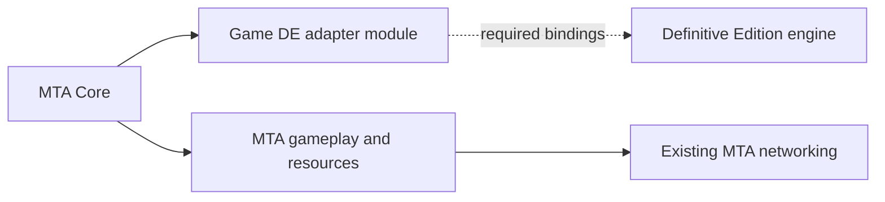

# MTA on Definitive Edition: reuse boundary

The October 13 user direction is to integrate the DE adapter into MTA. MTA owns
startup, input policy, gameplay, resources and networking. New backend work is
under `Client/game_de`, with Core consuming its SDK interface. The CLEO/UDP
experiment remains historical compatibility evidence.

The normal `MTASA` build target produces `game_de.dll`. Its versioned
`Client/sdk/game/CGameAdapter.h` contract receives the MTA owner and provides
Initialize/Pulse/Reset/Shutdown/Release. `CGameAdapterModule` in Core owns module
loading and unloads only after Shutdown and Release. Typed controller storage
now lives in `Client/game_de/ControllerSnapshot.h`; the old probe header includes
that implementation for compatibility.

`--with-definitive-adapter` enables Core's early adapter branch. It checks the
module and its gameplay capabilities before classic configuration, GUI, hooks
or game factories in the CCore constructor. Existing DLL-load file hooks and
the classic process-detection entry gate still precede that constructor.
The current adapter implements caller-observation ingestion and MTA digital
action synthesis. It supplies
no full `CGame`, engine input writes or remote player context, so startup returns
an explicit failure. Core/multiplayer/render startup also remains gated until
ported. The default classic build retains its original backend.

This is an MTA-owned integration and build boundary. A focused x64 host compiles
the same Core consumer and loads the actual adapter DLL; it does not construct
the full Core or launch GTA. The existing Core is still x86 and uses D3D9, and
its process detection does not yet accept the DE executable.

Normal MTA project builds and the real-DLL consumer tests pass. The module has
1,079 checks; the x64 consumer has 45 and its x86 rejection path has three.
Migrated controller storage passes 930 checks on each architecture. Classic
Release/Win32 Core translation units compile with the option enabled and with
the default configuration. Core was not linked or launched by these checks.
The final certificate binds 73 source files:
`Build/mta-owned-adapter-check/20261013-113152-f54e411c11b540eb9e6ec7f8b57577cc/test-result.json`.
See `Client/game_de/README.md` for the module/build contract.

The following input slice extracts the existing `CKeyBinds` digital controller
synthesis into `Shared/sdk/CControlStateSynthesis.h`. Classic Core now calls that
helper after its existing context-transition callbacks and before its existing
joystick merge and native pad writes. The DE module consumes the same helper
through ABI2 `SubmitControlActions` / `GetMtaInputState`, with per-instance
current/previous state and direction history. All 44 original action values are
retained in a shared header; invalid mask bits are rejected before mutation.
Logical MTA state includes walk and radio flags and remains separate from the
twenty-field native observation mask. No engine capability is inferred from it.
The early full-gameplay gate remains in place. The dedicated x86/x64 regression
runner compares the shared policy with the original committed implementation.

ABI3 adds an explicit read-only native pad binding inside `Client/game_de`.
It uses Plugin-SDK's SA Unreal signature/layout after an offline unique-match
check on the exact local executable. `NativePadReader` verifies that fingerprint,
the loaded instruction/relative data target, image bounds and page protections.
It copies native current/previous state on its binding thread; invalid reads
preserve output. No hooks or engine writes are installed. `EngineInputRead` is
advertised only while explicitly bound, and reset/shutdown discard the binding.
This is implemented source with static-image and bounded-copy tests, not an
in-game keyboard or remote-player validation. Full startup remains gated.

MTA's ordinary remote movement already combines synchronized controls and
sender velocity, GTA player simulation, and correction of network position
error. The next work follows those existing paths. A new receipt-speed estimator
and continuously forced `Walk_civi` playback are not the intended locomotion
implementation.

| Existing MTA component | Reuse or port work |
| --- | --- |
| `CNetAPI` pure sync | Keep controller/velocity synchronization and packet policy. Sender velocity is already read from the game; it does not have to be estimated from irregular received positions. |
| `CClientPed::SetControllerState`, `StreamedInPulse`, `UpdateKeysync` | Keep current/previous remote input state and client pulse policy. |
| `CClientPed::UpdateTargetPosition` | Share its pure incremental error correction. Keep native position/velocity, contact origins, jacking guards and game-speed thresholds in the backend caller. |
| `CInterpolator` / `CNetAPI::GetInterpolatorPosition` | Reuse timestamped local history for the existing latency-compensation role. It is distinct from remote player locomotion. |
| `CGame` and `CMultiplayer` module interfaces | Provide DE implementations behind the existing client module boundary. |
| `CPlayerPedSA`, `CPadSA`, pools and `ProcessControl` context hooks | Replace classic engine implementation/layouts with verified DE player, input and simulation bindings. |
| Existing MTA resources, Lua and gameplay logic | Retain as part of the end goal; the harness has not demonstrated compatibility. |

The current source traces are concrete:

- `Client/core/CCore.cpp::CreateGame` loads `game_sa` through `GetGameInterface`;
  `CreateMultiplayer` loads `multiplayer_sa` independently.
- `Client/mods/deathmatch/logic/CNetAPI.cpp::ReadPlayerPuresync` reads sender
  velocity and delivers target position/rotation to the existing client player.
- `CClientPed::SetControllerState` stores remote current/previous controls;
  `StreamedInPulse` combines interpolation with keysync.
- `Client/multiplayer_sa/multiplayer_keysync.cpp::HOOK_CPlayerPed__ProcessControl`
  switches to a remote player's pad/camera context, calls GTA player simulation,
  then restores local context.
- `CPlayerPedSA::SetMoveAnim` selects a movement animation group. The separate
  named-animation cache path supports explicitly requested scripted animations.

The first shared-code slice extracts the existing position correction into
`Shared/sdk/CPedPositionInterpolation.h`, consumed by the classic method and a
focused x86/x64 test harness. This keeps one implementation of MTA's policy.
The correction adds incremental network error to the **current engine position**;
it does not replace continuing engine movement with a target-position lerp.
Contact origins and caller-computed warp thresholds stay in the game layer.
The existing Windows client clock contract is preserved. This slice cannot
make a frozen civilian proxy behave as a remote MTA player.

The shared slice is now implemented and source-tested. `Advance` consumes the
incremental correction before native reads; `ApplyWarpThreshold` applies the
existing warp policy afterward. The classic caller persists progress/completion
before reading velocity, then looks up the live target and clears completion
only on a warp. This preserves ordering when the native velocity getter restores
invalid physics. `Update` composes both stages for consumers without that native
boundary.

`Tests/definitive/test_mta_ped_interpolation.ps1` compiles the self-contained
helper on x86 and x64 under `/W4 /WX /O2`. The final October 13 run passes
117 independently specified checks per architecture and binds seven source
hashes before/after. The required formatter and focused dry-run pass.
These focused tests do not prove a DE runtime binding. The existing Win32
Release deathmatch gameplay project now also compiles and links, including this
classic caller. Its `client.dll` build is recorded under
`Build/definitive-classic-build/20261013-080556-link/`. This is the gameplay
module; the complete core, loader, game, hooks and rendering stack is not built.

The second shared slice moves the original, unchanged 48-byte
`CControllerState` declaration from `CPad.h` to `Shared/sdk/CControllerState.h`.
Both classic MTA and the x64 harness consume that exact type. There are 219
runtime checks on each architecture, plus compile-time layout assertions.
`MtaControllerSnapshot.h` stages all 20 documented DE pad fields, publishes a
complete transaction once, and preserves published history on invalid or
partial input. Its 930 checks pass on each architecture. Seven additive bridge
exports enforce the bound game thread and retain ABI version 2.

The next game test is a read-only local input reference, selected with
`set-mode.ps1 -Mode Smoke -NativeInputReference`. Ctrl+Shift+F9 activates one bounded
30-second observation while the human stands, walks and sprints normally.
No transport, remote ped or game-input writes are used. Each raw input sample
passes through the canonical C++ type and is read back before logging alongside
native velocity and position. Previous state means the previous probe sample,
not GTA's previous frame. Start and cleanup reset the snapshot masks.

The pinned 0.500 definitions expose pad indices 0–19 and `GET_CHAR_VELOCITY`.
The four MTA-specific logical fields remain explicitly unknown, and velocity
units remain unknown. Metadata support is not runtime verification. The saved
log reader checks ownership, masks, provenance, clocks, bounds and cleanup;
observed analog, velocity and sprint-button activity are separate findings.
This test can establish a local read binding, not remote input simulation,
native walk/jog classification or complete MTA compatibility.

The first local-input attempt captured 22 idle samples and reset cleanly after
a render gap. The human confirmed normal movement, then identified Home opening
the Rockstar console as the interruption. It does not validate movement input
or velocity. The input reference now uses F9; legacy experiments retain Home.

The F9 retry completed its 30-second budget with 227 accepted samples, cleanup
and normal exit. The human used keyboard/mouse and reported normal walking and
sprinting. Raw engine velocity changed in 192 samples, while all 4,540 pad
values remained zero. Stream validity and velocity observation do not establish
keyboard aggregation or physical input mapping. The full trial is preserved
with the pinned source/install hashes; changing PadId to 1 is not supported by
the metadata or public implementation evidence.

The build boundary also needs work. Core, game, multiplayer, deathmatch and
loader projects currently exclude non-x86 builds. SDK interfaces expose classic
`CEntitySAInterface`, `CPedSAInterface` and RenderWare clumps; core graphics use
D3D9 interfaces. These dependencies must be isolated or given DE implementations
before the complete client can run as x64. Simply removing architecture filters
would leave classic addresses, object layouts and hooks in the DE process.

The next backend work stays inside MTA: port Core startup and provide the real
`CGame`/multiplayer services required by its existing client. Input comes from
MTA's configured action system and needs a verified DE engine application path;
remote player simulation needs its own player data and game-thread context.
Natural gait and the shared MTA correction follow those services. Each engine
binding needs evidence on the pinned executable, including restoration and
cleanup. Unsupported bindings remain unavailable.

The custom UDP harness currently carries only transforms, with no sender
velocity or input state. It can validate native operations but cannot stand in
for the above MTA network/game contracts. Its successful NPC walking reference
and October 13 root-lock comparison remain scoped compatibility results.

For commits, include the user's MTA-reuse goal, the exact existing code shared,
why engine-specific operations stay behind the backend, x86/x64 verification,
and the remaining complete-client/gameplay limits.
