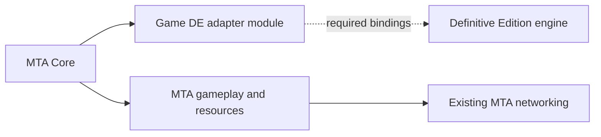

# MTA on Definitive Edition: reuse boundary

The October 13 user direction is to integrate the DE adapter into MTA. MTA owns
startup, input policy, gameplay, resources and networking. New backend work is
under `Client/game_de`, with Core consuming its SDK interface. The CLEO/UDP
experiment remains historical compatibility evidence.

The October 21 native weapon backend now supplies the complete existing
`CWeaponInfo` interface through eighty stable SDK objects. `CGameDE` uses MTA's
shared weapon/skill selection and the existing engine callback owner to obtain
these objects. Scalar setters, native slot selection and fire-offset updates
write the qualified DE bank; the fire-offset getter preserves MTA's borrowed
native vector contract. Interrupted vector updates retain their exact component
journal until an admitted callback can retire owned changes, preserving later
engine edits. This completes the weapon-info object rather than the still
abstract `CGame`, native ped/weapon gameplay objects or network client. Offline
fixtures and the normal backend build remain distinct from live GTA validation;
the previously installed candidate stays available for the deferred combined
test. The port remains experimental.

The native weather extension reuses that same callback owner for eight scalar
override groups. Constrained allocation placement preserves displacement bytes
outside the selected aligned 64-bit word, admitting all thirty-seven direct writers
without a partial instruction write or a 128-bit CPU requirement. Actual
allocation bases and interior accumulator addresses have distinct retained
identities. Reset restores native progression without rewinding an accepted
scalar value. Rain additionally owns its directional archive entry and lifetime.
The complete `CWeatherOverridesDE` object is borrowed through admitted
`CGameDE::GetWeather`; it does not complete the enclosing `CGame`. Separately, actual `CStats`
reads now use the qualified DE float/integer banks and weapon-skill classifier.
The complete four-method `CStatsDE` also delegates Set/Modify to the qualified
native reaction transactions through this same runtime. `CGameDE::GetStats`
publishes its stable SDK object; writes require actual playing state, loaded
player identity and the native setter's additional script prerequisite. An
entered failure preserves any native effects and stops the lease without
replaying the transaction or restoring a guessed bank snapshot. These native
calls are implemented and checked offline; live validation remains separate.

`CGameDE::StartGame` now forwards MTA's existing SDK request to the actual named
DE frontend/loading action. A separate internal startup mode uses the existing
normal post-original game-mode frame hook, generation and retirement machinery.
The public application-frame observer remains read-only. The admitted call
checks the native initialized GameThread identity, scoped GC marker, current
typed owner/world/providers, configured transition classes and immediate UObject
registry identities. Its final entry claim consumes one attempt per generation;
missing prerequisites consume none. The real action performs frontend teardown
and requests asynchronous loading. Return does not certify a loaded world, and
an entered failure preserves native effects without replay or a state8 shortcut.
This extends the partial backend; the complete `CGame` factory, native gameplay
objects and x64 network module still remain prerequisites for full MTA startup.

The retained startup owner now observes the native loading pump after that
generation's real request was entered and published. The native state, pending
request and pump latch must all match the freshly admitted application receiver;
an opaque identity comparison ties these observations to the original request.
State9/request0/pump0 can predate a new request, so those values alone supply no
transaction history. The observation reports native pump retirement and leaves
MTA's existing loaded-session checks responsible for player/network readiness.

MTA's `CreateWeaponStat` factory also shares its existing defaults and flag
transition policy between classic and DE. The complete owned `CWeaponStat`
contains custom CPU data, as the classic unlisted factory does; its mutable
fire-offset vector belongs to that object. Classic manager originals remain
mutable and are looked up at each constrained flag transition. Custom weapon
execution separately uses the real native weapon-info bank. The live weapon-stat
manager still requires its remaining qualified native setters.

The native `CWeaponStatNativeDE` slice now borrows those same stable bank
objects and callback writer, including model/fire type, animation loops, aim
offset and default-combo fields. Flag changes reuse MTA's shared policy and
resolve mutable originals at each transition. Persistent writes preserve
accepted effects and later native edits if a subsequent operation loses its
lease. The native combo-count setter remains pure; the live manager is not
published from this partial slice. This differs from the complete owned CPU
stat returned by `CreateWeaponStat`.

The manager's existing first-match lookup, skill selection and deliberately
disabled list reset also share one SDK policy between classic and DE. The DE
manager slice owns 76 typed CPU originals in classic insertion order, including
duplicate standard records, and borrows live SDK identities through explicit
registration. Metadata edits and mutable originals remain observable; unlisted
CPU stats keep their original-provider lifetime contract. Native wrapper
creation stays pure, so this slice does not publish `GetWeaponStatManager`.

`CGameTimingDE::GetGravity` also reads the current qualified native downward
acceleration operand through the existing timing-reader binding. It preserves
finite binary32 values and refuses changed image/code/read prerequisites.
The separate oriented-force operand and unrelated sample/filter consumers
prevent treating this pooled constant as a mutable world-gravity property.
`SetGravity` remains pure until those consumers and override lifetime are
qualified independently.

MTA's nineteen world-cheat names and four set permissions now share one SDK
policy with the classic backend. The DE reader supplies fourteen independently
qualified native flags through the existing callback owner, preserving the
classic nonzero-byte read contract. Writes remain limited to the original four
properties. Five native identities remain unresolved, so full `ResetCheats`
and `PerformChecks` remain pure. The native all-cheats initializer also changes
time scale and weather; it cannot replace MTA's registered-row reset. Faster
clock reads reuse the clock owner's exact stock or owned freeze identity.

Rain's shared runtime now retains its own near RX leaf, separate RW descriptor
and exact direct-writer/entry journals. Loads advance the real synchronous
archive through a temporary value, while saves retain native Rain reads. Stack
bounds come from independent NT_TIB/current-thread facts; unreadable, changed,
fiber or borrowed stacks refuse admission. The same parked peer set must pass
old/new continuation checks before either entry exchange and allocation release.
A bounded native enumeration rejects unexpected threads without a loader lookup
or growing collection under the hold; it supplies no future global thread-birth
lock. Partial operations retain exact code, protection, cache, handle and
allocation debt. The complete SDK implementation is checked offline; this does
not claim live weather or full MTA readiness.

The October 19 application-frame trial observed 277 natural gameplay frames
and both configured UI dictionary entries without engine writes, then retired
its hooks and unloaded Core normally. A combined startup observer now reuses
that same MTA worker and native lease for declared UI-class relations, the
enclosing game-mode/interface correlation and a conservative world link. Its
256-byte SDK record and 192-word report distinguish missing prerequisites,
wrong types and refused reads. Runtime `a089e0c7b` passed the combined gameplay
trial: all 65 frames confirmed both UI types and the owner/world links, with no
refused observations and complete native/Core cleanup. All 14 saved logs and
normal shutdown are pinned by
`Build/definitive-recovery/current-actual-startup-observation-checkpoint.json`.
This does not establish UObject lifetime, controller/UI provider readiness,
cold frontend readiness or permission to call native startup methods. Existing
networking remains MTA's responsibility.

The October 20 native-main-menu attempt with runtime `6f2d628ff` reached JS
entry and arming before CJ existed, but the activation chord produced no new
log event and never loaded Core or the Bridge. The user reported normal GTA
continuation. All fourteen raw logs, unchanged installed hashes and normal
shutdown are preserved separately in
`Build/definitive-recovery/current-startup-observation-frontend-attempt.json`.
This was an unstarted workload, not a failed native-frame observation. It does
not replace the successful gameplay certificate above. Startup observation
now uses frame yields and bounded chord-only receipts to distinguish script
resumption from key delivery at the frontend; the same MTA worker, native lease
and 192-word report remain in use. This scheduling change awaits a live check.

The native frontend entry now offers a path independent of that CLEO scheduling
boundary. Its explicit native package starts the existing retained Core worker
hidden from the pinned loader's `InitializeASI` callback, claims the same single
controller and uses the same mailbox, heartbeat and cleanup. A native thread
reads foreground activation chords; CLEO returns without claiming another owner.
The real Core retains localization, local command and console log services across
hidden periods, using shared normal-startup construction and rollback.

The combined October 20 GTA check on `f556dd92f` passed: hidden Core was ready
32 ms after the native controller started, before CLEO resumed; the first Show
command arrived 111.688 s after startup. Two actual menu views produced 179 and
298 presents and retired with restored input scopes and detached cursor hooks.
The user confirmed I movement/sprinting, I retained on reopening and ordinary
W/camera restoration after End. All 15 run logs and normal shutdown are saved
against the 14 existing-log baseline. The native-main-menu location is human
reported, rather than proved by these logs. The existing missing
`cgui/images/question.png` error reproduced. Expected process pinning can keep
`game_de.dll` mapped after its callbacks end. Native view gates still apply;
visible playerless GUI, full `CGame`, client and network readiness remain open.

The following offline update packages the four existing MTA message-box icons
as a complete optional group, producing 62-file frontends and 64-file native
packages while retaining historical ownership layouts. MTA's normal x64
launcher preflight and loader switch now admit native startup and those assets,
including INI/configuration agreement. This is package/launcher admission; it
neither replaces the real network module nor opens a full-client launch path.

The next startup batch adds explicit `--de-launch` to that same MTA launcher.
Preparation checks the registered Steam library, app 1547000, exact installed
native package and ownership receipt before MTA's existing shell helper can
request Steam startup. Preparation is independently testable without dispatch.
The request result deliberately remains separate from in-game Core readiness.

Native view admission now reuses the backend's checked game-state reader and
the same local-identity predicate used for movement. Known frontend/loading
or qualified ineligible states retain hidden Core without creating a view or
arming initial local input. Another explicit F9 can retry after context changes;
missing evidence and mutated owner reports still fail. No playerless GUI or
complete `CGame` is fabricated. The October 20 check on `8697e3f13` confirmed
actual MTA-to-Steam launch, hidden Core ready in 47 ms, a nonterminal first
Show and a later explicit GUI view with 65 frames/presents. That view restored
205/205 input scopes with zero failures and detached the cursor hook after
suppressing 197 engine warps. End unloaded Core/GUI/XML/pthread, and GTA exited
normally. The user reported all combined steps worked, but this session logged
two Show commands and only one actual GUI view; a separate reopening is not
claimed. The earlier two-view result remains separate. Raw logs, offsets,
current-PID/module evidence and normal shutdown are pinned by
`Build/definitive-recovery/current-actual-steam-startup-checkpoint.json`.

The standalone launcher also offers `--de-launch-installed`: Steam registration
and the appmanifest locate the game, and its adjacent native ownership receipt
provides the files to validate. It shares the existing game/PE/hash/config/INI
policy without constructing package provenance or requiring workspace paths.
The normal launcher build and both preparation modes passed 22 process cases,
15 VDF parser checks and 25 discovery/layout checks. Positive installed checks
call only the new preparation export; this selector has not dispatched Steam
in the offline batch. Core, backend, Bridge, GUI and all 64 installed files are
reused unchanged from the live-tested candidate.

The real Deathmatch client now builds and links for Release/x64 using MTA's
existing code. Engine work is assembling its actual `CGame` services:
`CClockDE`, the complete four-method `CKeyGenDE`, eight native timing getters,
and scale/game-speed/minute-duration/pause setters on the existing engine owner.
An internal timer continuation keeps pause restoration available while the
clock/weather path is skipped; the public clock V1 contract is unchanged.
Nine streaming-ID getters use verified DE operands and the full 26316-row count,
without exposing DE rows through classic structures. These new pause and
streaming paths have not yet been exercised through a live full `CGame`.
`GetSystemState` separately maps the proved native frontend/loading/gameplay
states through a checked reader. Early native states 0–5 and lifecycle writes
remain unsupported; native indices are never blindly cast into the SDK enum.
`IsAtMenu` observes both the typed SA menu-widget owner and legacy frontend
screens. It keeps their read qualification separate from native lifecycle calls;
no widget is dereferenced and matching snapshots do not claim an engine lock.
`CGameDE` supplies real clock/keygen accessors but remains abstract until the
other subsystems exist. The exported factory therefore still supplies no full
game interface, and client startup/networking remain incomplete.

The existing asynchronous model-loading policy is now shared by classic and
DE through `Shared/sdk/CAsyncLoadingPolicy.h`. DE's three actual `CGame`
methods reuse MTA's script override, temporary suspension and strict deadline
rules; their timer remains independent of paused game time. These methods
control MTA scheduling, not native streaming rows or model-request lifetime.
The policy and DE clock wrapper passed 65 checks on each of x86 and x64, and
the changed classic `CGameSA` translation unit compiled from the normal project.

Retained frontend owners also have an explicit movement-binding persistence
opt-in. `MTA_EnableDEFrontendBindingPersistenceV1` uses MTA's user-data directory;
the `AtPathV1` variant supports an explicitly owned host path. Both reuse the
existing frontend handle, owner-thread admission, XML factory and `CKeyBinds`.
Only the six supported movement controls are written to
`definitive/keybinds.xml`; the installed `coreconfig.xml` stays unchanged.
Settings stages a separate manager, commits the generated file atomically,
then swaps in the staged manager. A failed save leaves the prior file and
bindings active, and Cancel discards edits. Existing diagnostic/session APIs
remain session-only unless their retained owner explicitly opts in. This
feature does not start GTA, networking or a second configuration lifecycle.
The retained runtime now exposes the matching owner-level
`MTA_EnableDEFrontendRuntimeBindingPersistenceV1` / `AtPathV1` calls so the worker
can load bindings while hidden, before GUI or local input borrows them. The
additive Bridge start `DE_LocalInputRuntimeStartPersistentV1` and package option
`-MtaCoreFrontendRuntime -MtaCoreFrontendBindingPersistence` select that path.
Legacy starts preserve session-only semantics. Missing or refused persistence
APIs stop and clean up the requested runtime instead of quietly losing Apply.

The DE clock service now implements MTA's existing five-method `CClock`
interface behind an optional Core-owned adapter contract. Commands cross a
mailbox to the exact-image native continuation after clock progression; Core
does not write engine time from its worker thread. After mutation, the bounded
lease restores captured displayed time and fractional-minute phase without
rewinding the native timer. A read-only session instead retires using verified
current values, allowing natural progression without clock writes. Clock
transactions exclude native input/render ownership and retain failed patch,
protection, data or thread-resume cleanup for retry.
This is one service toward the real `CGame` implementation. It does not expose
a partial `CGame` or enable gameplay capabilities. Read-only live behavior and
the later bounded single-Set recipe are established for their separate runtimes
below; live freezing remains untested.

The first live candidate is the separate Smoke opt-in
`-MtaCoreClockReference`, using the existing Core startup worker and optional
`CClock` provider. It owns only the base 23 files and excludes every GUI,
rendering, input and other trial. It submits Read commands only, with no GUI,
NPC, network connection, player-input write or game-time write. The F9 arming
gate waits indefinitely, then requires release before the ten-second readiness
window and up to ten seconds of observation. Generation-bound acknowledgements
and advancing native time are workload proof; safe retirement is a separate
requirement before Core unload. Ordinary mode changes clear the opt-in, while
intact historical configurations without its declaration require an update to
enable it.

The October 18 runtime `d9de393a1078deb12432bcdd984357eefb60b261` passed its
actual Read trial: **198 acknowledged Reads**, **608 qualified callbacks**,
**200 timer-progress observations** and **10,000 ms** of workload. The user
reported normal GTA continuation. Independent validation covered all 88 logged
samples with **5,033 protocol checks** plus **51 metadata/layout checks**.
Native ownership retired and Core/GUI/XML/pthread unloaded. Normal exit kept
all fourteen live log prefixes and 23 installed hashes exact, with only 74 new
CLEO shutdown bytes. The machine exit code is unknown; saved shutdown markers,
process absence and the human report supply the qualified normal-exit proof.
The source cohort was frozen before later changes and sealed with the raw
recording at `Build/definitive-recovery/current-actual-clock-read-checkpoint.json`.

The separate trial, `-MtaCoreClockSetReference`, keeps base 23-file
Smoke ownership and reuses the optional `CClock` provider for controlled
Set/Read commands and native restoration. Its default-false
`MTA_CORE_CLOCK_SET_REFERENCE` flag excludes the completed Read flag and all
input/render/GUI trials. The distinct mode18 / API1 / 128-field Bridge/Core
report preserves Read's mode17 / 96-field contract; no new MJS module or
separate game lifecycle is introduced. GUI, NPC, network and player-input
operations are outside this candidate. Its offline validation passed the
normal Core/Game DE build, 710 native checks, 670 Set lifecycle checks per
x86/x64 architecture, 125 worker cases, 1,202 script checks and the
980-check Set package matrix.

Runtime `f749e634f1b8227123bb035a0868d4e614d620fa` passed this recipe in GTA on
October 18: from an initial producer Read of **19:11:53**, it issued **one Set
to 12:15**, acknowledged after **62 ms**, then completed **97 subsequent Reads /
98 total Read acknowledgements** through **12:19:43**. The **5,000 ms** workload
recorded **305 qualified callbacks** and **101 timer-progress observations**.
The user reported normal GTA continuation and a visible time change. All
**45 saved samples** passed **3,348 independent checks**.

End restored the provider's captured **19:11:48** and fractional phase. The
earlier provider capture and later producer Read are distinct observations;
their equality is not part of the restoration proof. Native hooks, commands,
peer holds and recovery debt retired, and Core/GUI/XML/pthread were absent from
the final module snapshot. Normal exit passed **159 checks**, preserving all
fourteen log prefixes and 23 installed hashes; only CLEO added its 74 shutdown
bytes. The OS exit code remains unknown, separately from the human normal-exit
report, process absence and ordered shutdown/Exit markers. The new evidence
pointer is `Build/definitive-recovery/current-actual-clock-set-checkpoint.json`;
the earlier Read and Settings evidence remains separate.

Live Freeze, Unfreeze and ResetTimeFrozen remain untested. This bounded result
does not unlock full MTA gameplay or networking, and the port remains
EXPERIMENTAL.

Visible GUI integration continues inside Core using the existing CGUI/CEGUI
renderer. The new opt-in surface attaches an MTA-owned transparent child window
to GTA's validated window and uses the retained D3D12 device with its own queue
and composition swapchain. Native observation ends before GUI or window work.
This provides a bounded visible-output trial while native backbuffer rendering
remains gated on safe resize/destruction handling. It does not replace MTA's
GUI, unlock full startup or establish multiplayer readiness. Actual on-screen
output must be verified separately from readback and compositor submission.

Current checkpoint: actual MTA Core owns saved XML configuration, its existing
`CKeyBinds`, adapter pulse and digital synthesis on the startup worker. Its
corrected scoped-write session passed **30,009 ms**, **595 native samples and
259 script snapshots** with forward, isolated forward walk, isolated forward
sprint and neutral coverage. All **1,801 applications restored**, with
**61,299 routed queries** and zero native failures; the human reported normal
walking and actual sprinting. Both canonical frames ended neutral, Core/XML
unloaded, the backend PIN matched and all 23 hashes passed. Normal exit passed
with the complete 99,637-byte shutdown log. This establishes
bounded local forward input through MTA, while full gameplay/render/network
capabilities stay gated and the port stays EXPERIMENTAL.

Core's existing module-loading sequence lives in `CreateStartupModules`.
Both classic renderer paths delegate to it, preserving
Network/Game/Multiplayer/XML/GUI order, the early reentrancy flag and existing
failure handling. DE admission now precedes the flag and every classic module
load, including direct calls to that method. The full startup rejection stays
in place until the remaining systems are ported.

Core's DE `CreateGame` now requests a borrowed `CGame` facade from its selected
adapter. The accessor requires the owning thread, an explicit capability and
a nonnull facade, preserving output on rejection. Core records the ownership
and leaves teardown to the adapter's successful Shutdown/Release sequence.
Classic factory/version checks and Terminate behavior remain on the classic
path. The production DE adapter still exposes no facade; opaque fixture
pointers verify lease policy without pretending to implement CGame.

The opt-in x64 MTA launcher also has a headless file preflight through its
existing loader dispatch. It verifies the supported executable and a coherent
23-file owned bundle without starting GTA or loading Core. Its valid result
explicitly leaves launch readiness and full MTA readiness false. See the
[preflight contract](../launch/DefinitivePreflight/README.md).

The active native renderer is now observed through actual Core on D3D12.
The latest ten-second API4 trial recorded 606 native callback entries and 603
accepted scalar snapshots. All 87 logged snapshots contain complete GPU
metadata and recognize the pinned Gameface native custom presenter. The
human reported normal GTA continuation; cleanup, all 23 installed hashes
and normal exit passed. The read-only probe still rejects GPU ownership:
603 rejected probes, zero accepted. Presenter identity does not establish
the resource state, final queue ordering or a safe drawing boundary.

The optional render factories preserve adapter ABI6 and older observation
ABIs. Core ends each lease before adapter teardown and retains ownership on
detach or final-readback failure. API1/2 copy scalars without COM calls;
API3/4 query and release callback-local COM references without issuing GPU
commands. The source flags remain disabled by default, with indefinite
manual F9 arming before each bounded trial.

The API5 observer reuses the same Core owner and worker. It scopes
the standard DXGI Present entry to the pinned native caller, after the Social
Club callback, and copies 110 scalar fields. Exact swapchain/backbuffer/queue
association, CPU tracker values and resize/destruction counters are separate
from GPU ownership: even a coherent association cannot authorize drawing.
Native endpoint and detour ownership checks refuse changed code and retain
the module when cleanup cannot finish. The completed trial continued normally
and passed cleanup/normal exit, but all 87 samples refused endpoint admission;
no standard Present or backbuffer association was observed. A separate optional
20-scalar diagnostic now reports the preparation gate and module-relative
slot/branch categories to the same Core worker. The completed diagnostic
identifies a loaded-code hash mismatch: the expected DXGI Present entry was
already patched with an E9 branch to private executable memory before MTA's
hook installation. The native swapchain slot still equals DXGI RVA `0x19000`.
The relay's memory category does not identify its owning DLL. Core logs those
values under the explicit DE root; the next native integration must preserve
the existing Present chain. It changes no observation wire or drawing guard.
No GUI assets, input writes or GPU commands are included.

API6 keeps that result intact and appends a separate native dispatch record.
Its source-pinned callsite intercept forwards the existing swapchain slot
target, so a pre-existing DXGI patch need not be replaced or trusted as MTA's
own code. Core owns the same typed adapter lease and worker lifecycle; the
bridge transports 136 scalars through a distinct opt-in version. Profile2
describes native dispatch and CPU object association, while API5's profile1
still describes an admitted system DXGI entry. Neither grants GPU ownership.
Offline publication/rollback checks and normal MTA builds pass. The latest
primary-backbuffer API6 trial recorded 603 native callbacks, 601 accepted
snapshots and 601 native dispatches with no association rejection. All 87
logged samples contain coherent profile 2 association, complete queries,
`S_OK` probe and forwarded results, and matching native/DXGI buffer indices.
Ten fresh roots reports completed their after-Close readback. Cleanup, all
23 installed hashes and normal exit passed, preserving the full 46,055-byte
capture plus 74 shutdown bytes and unchanged diagnostic logs. This validates
native CPU/COM association. GPU ownership remains unsupported with zero
accepted probes, and the system DXGI API5 endpoint remains unadmitted.
No GPU commands, drawing or full client readiness are established.

The preceding roots-diagnostic API6 trial installed hooks after three stable passes with 187 initial/peak
holds. It recorded 606 native callbacks, 601 accepted scalar snapshots and 87
complete metadata/known-presenter reports. Native dispatch intercepted and
forwarded 601 calls, but all association queries refused at `NativeRoots` with
probe `E_POINTER`; forwarded target results were `S_OK`. All 11 fresh roots
reports identify a successful selected-texture read followed by `RequiredNull`
at checkpoint 22. The selector branch, primary slot value and underlying cause
remain unknown; unsampled queries and earlier trials have no new cause claim.
Cleanup, all 23 installed hashes and normal exit passed, preserving
46,824 captured bytes plus 74 shutdown bytes and unchanged diagnostic logs.
This proves bounded interception, not admitted buffers or GPU drawing.

The narrow correction removes an extra command-data dereference exposed
by pinned native instructions. Its owned full-graph regression fails on the
old reader and passes after the fix; 3,650 native checks plus four
unavailable-build checks pass. MTA still owns the Core worker, typed adapter lease and cleanup;
the native correction supplies no separate client or rendering bypass. Its
live result still refused. A separate 14-scalar read/refusal diagnostic uses the same MTA
lease and worker. It preserves all existing reads, guards and the 136-scalar
observation, publishes only accepted-callback cache values and logs outside
the callback. Its strict reader binds fresh PID/run/generation evidence;
diagnostic success cannot admit buffers, GPU commands or full startup. The
next correction follows the primary `viewport+0xA8` backbuffer used by native
resource preparation, rather than requiring its nullable format-dependent
alternate. Existing selector/coherence, canonical buffer identity, resource
state and cleanup guards remain; the subsequent trial validates that corrected
association without changing the GPU ownership gate.

The preceding API6 attempt returned HookInstall with zero callbacks. Its setup
report identifies `StableLimit` (stage 21), no OS error, 189 initial/peak holds
and four discovery passes entered. No transaction or hook write began; cleanup
and normal exit passed. The exact limit branch, object identity, liveness and
cause remain unknown. The next correction passes 3,617 native checks plus four
unavailable-build checks. Bounded continuation uses a disjoint VM-backed cache
of exact exited objects: first sightings reset stability, repeats require fresh
exit proof and pinned native identity comparison. The four-pass limit and two
consecutive stable passes remain. Standalone owned proofs pass 27 continuation
and 34 identity checks without establishing the actual game's limit cause.

The preceding API6 attempt also returned HookInstall with zero callbacks. Its separate
setup report identifies `StableSuspend`/Win32 access denied (5), before any
transaction or hook write. All 190 initial holds were released; cleanup and
normal exit passed. The failed thread's liveness is unknown. An owned 350-check
Windows test reproduces the same error for exited and live restricted threads.
The correction passes 3,483 native checks plus four unavailable-build checks. It
skips only a proven exited handle and restarts bounded discovery; live or unknown
threads still refuse. Retained exited objects can still reach the four-pass
limit safely. Complete owned install/detach coverage includes shared-page
protection and suspension-count restoration.
The earlier strict DXGI mismatch is tolerated during preparation.

The GUI backend reuses MTA's actual CGUI/CEGUI widgets, skins, fonts and
textures. Owned offscreen WARP tests cover BGRA8, RGBA8 and the observed
R10G10B10A2_UNORM target, including pending-frame retention and teardown.
Those tests do not establish visible GTA rendering, HDR or color-space
correctness. Those earlier tests ran without installing GUI assets into GTA.
An additive asset-root export now configures cgui independently of Core,
avoiding classic folder discovery when both DLLs live beside the DE bridge.
The actual `Win64/CLEO/de-online` layout passes 510 offscreen D3D12 checks
across the three formats; the existing D3D9 path passes 93 checks.
Owned swapchain tests now pass 777 checks against real three-buffer DXGI
swapchains in formats 24/87/28, including fence retention, two resizes per
format and shutdown without another frame. The Core GUI helper passes 103
checks for actual CGUI rendering, fresh asset/log paths, pending fences,
signal recovery and irreversible release faults. Debug-layer validation was
unavailable; these tests do not claim it.

The first actual-device startup trial passed. It adds an explicit one-shot retained
device handoff. Ordinary API6 observers retain no device and keep the existing
136-scalar contract. Core preloads the existing cgui assets, requests the new
lease, and detaches the observer before creating its own queue and fixed BGRA8
offscreen target. It reuses the actual MTA widgets and verifies fenced pixel
readback. Separate Core11 / GUI API1 reports contain 64 scalars, with native
association, owned GPU work and cleanup checked independently. Pending drains
retain all owners; unknown release faults never authorize an unload.

`package.ps1 -Mode Smoke -MtaCoreGuiStartupReference` explicitly selects this
36-file trial; the ordinary package remains 23 files and the source flag stays
false. The completed test renders offscreen with no visible overlay or
movement. The existing 23-file launcher preflight is separate and does not
validate the GUI bundle.

The live trial completed in 401 ms on Core and 523 ms on the script. One
coherent profile-2 device lease produced the actual 640x480 BGRA8 GUI workload:
two helper clear/copy submissions, one CGUI frame, fence 1/1 and 133,058 changed
pixels with background/texture/alpha checks. Core/cgui/XML/pthread unloaded,
the backend PIN matched, all 36 installed hashes passed, and normal GTA exit
preserved the 6,580-byte capture plus 74 shutdown bytes. The 219-byte Core GUI
log is unchanged. This establishes actual-device offscreen GUI rendering;
native frame drawing, full startup and multiplayer remain gated.

The next visible integration must preserve the existing renderer and establish
a new native/Core ownership contract. `IGuiD3D12Session::RenderFrame` already
records barriers, submits work and signals its supplied queue. The existing
API6 facts and one-shot device lease grant no authority for those operations on
the native queue or backbuffer. Admission needs a source-pinned boundary after
native rendering and the Social Club callback, before the actual Present, with
the required resource state and submission order established independently.
Same-queue ordering alone does not establish where native work is submitted.
See Microsoft's [submission contract](https://learn.microsoft.com/en-us/windows/win32/api/d3d12/nf-d3d12-id3d12commandqueue-executecommandlists).

The pinned profile-2 seam already sits after the custom-present/Social Club
callback and immediately before the vtable `+0x40` dispatch. The existing
`HookNativeDispatch` preserves the captured target and forwards it once.
Static native paths place final barriers and queue submission before the
wrapper; API6 now confirms the selected context/manager/queue/device and current
`GetBuffer` identity. The separately pinned native `CreateSwapChain` path
establishes the creation-queue relation; `GetDevice` supplies device identity.
The CPU tracker value is still intent, not a GPU state read. A new explicit
write lease must declare its state/order policy;
inferring the valid game's PRESENT contract must stay explicit.

Core should prepare cgui and register a retained callback owner on its worker,
then create/use the real session and widgets on the authorized render thread.
The current offscreen helper stays worker-owned and continues to end observation
before starting GPU work. Full `CCore` frame pulses remain gated because their
gameplay dependencies are not initialized by this diagnostic startup.

The native producer must also coordinate pause, resize/destruction and stop:

- Deliver only a validated frame with strong device/creation-queue/current-buffer
  references and explicit generation, resize epoch, index, format, dimensions
  and resource-state/submission policy. Reject foreign or nested delivery.
- Stop admission before resize, drain GUI work on its owner thread, and release
  every external backbuffer reference before forwarding the native operation.
  Revalidate afterward and recreate the session on device/queue/format changes.
  Current resize/destruction hooks count and immediately forward, so they do
  not provide this handshake. See the [DXGI resize requirements](https://learn.microsoft.com/en-us/windows/win32/api/dxgi/nf-dxgi-idxgiswapchain-resizebuffers).
- Make an owner-thread drain callback reachable without another Present.
  Cancellation requests stop atomically; Busy/error retains Core, cgui, the
  session and backend until GPU retirement and callback quiescence. Cleanup
  cannot move to the worker or detach the callback while it is still needed.

Pinned resize entry precedes a native manager drain and custom notification,
then the first buffer release. Admission must close at entry; the later
notification alone cannot quiesce in-flight GUI work. The destruction path has
no equivalent established manager drain. Neither path currently proves that
it runs on the GUI's render owner or guarantees a final owner-thread callback.

Before another live drawing trial, extend the existing owned three-buffer WARP
fixture through this Core/backend handshake. Cover actual widget pixels, one
Present forwarding per call, blocked-queue retention, resize/recreation,
foreign/nested refusal, and cancellation with a drain but no later Present.
Keep API6, the GUI v1 session and the completed GUI64 offscreen trial unchanged.

The preceding read-only live session ran for **60,003 ms**,
with **1,188 native samples and 515 script snapshots**. Four directions, sprint
and neutral were observed. Walk remains untested because the human was unsure
which Shift key was used; the strict reader reports `movement_coverage_missing`
while confirming a clean lifecycle. Both controller frames ended neutral,
bind/XML/adapter owners were released, Core and Game DE unloaded, normal GTA
exit passed and all 23 installed hashes matched. That run explicitly assumed
on-foot context and performed no engine writes.

The configured-write trial connects this actual Core producer to the existing scoped
native writer. Select `package.ps1 -Mode Smoke -MtaCoreMovementReference`;
source defaults and ordinary mode changes disable it. The 23-file package uses
the real Core, Game DE and XML modules plus saved MTA binding records. The
bridge schedules one worker and captures coherent value-only snapshots. It
contains no replacement bind manager, physical-key map or fixed action sweep.
The first live combined trial stopped after 1,049 ms because a producer
eligibility observation became unavailable. Its 20 native samples and 10
script snapshots record 63 applied/restored scopes without native failures.
Right Shift reached the walk action without forward input; that first trial did
not validate combined forward walking or sprint. Cleanup, normal exit and all 23 hashes
passed. The human's normal movement report does not extend this short capture.

ABI6 provides build-pinned local movement eligibility. Admission requires the
verified local player/provider/pad0 identity, native InVehicle flag clear,
`PED_IDLE` and controls-disable word zero. Known mask and positive flags must
both equal `0xF`; only forwards/backwards/left/right/sprint/walk are admitted.
Other context defaults remain unknown and cannot authorize weapon/task actions.
The active producer uses fresh, generation/identity-bound eligibility published
by the verified callback. Engine code temporarily borrows the provider index
and alternate-pad globals for other characters, so concurrent worker reads
cannot establish the local callback's current phase. Before Begin, unavailable
observations wait within the bounded readiness window with no writes. The
complete live guard still runs before every native callback write.
There is no full task/death/health discovery or remote ownership claim.

After F9 activation and release, focused configured keys must reach a neutral
baseline. Core then starts a 30-second write window using the existing native
mailbox, provider routing and 96-byte pad transaction. The native writer retains
its independent 35-second expiry and two-second freshness limit. End disarms
first; a pending restoration/detachment keeps the real Core and worker alive
for retries even after cleanup deadline reporting. Two neutral publications
clear canonical current and previous state before bind/XML cleanup and the
terminal snapshot. Core is released afterward. Snapshot field 94 reports the
actual successful Game DE module PIN: its continued presence is expected after
PIN, while native hooks and adapter ownership must be fully ended.

Assess the saved combined trial with
`python utils/definitive_edition/core_movement_log.py --log <saved-log> --output <assessment> --require-exit`.
A complete report requires forward, isolated forward walk, isolated forward
sprint and neutral coverage plus native scope/restoration and worker-cleanup
proof. The new guard's focused suites pass 1,259 native callback checks and
1,520 adapter-module checks. Normal Core/Game DE builds and 114 actual Core
entry checks in each classic/DE layout pass. These are offline checks; package
and live evidence remain separately qualified. Full MTA startup, CGame,
resources, networking, launcher integration and DE rendering remain gated.

Earlier validated boundaries remain useful evidence. The ABI5 fixed-phase
script trial recorded 1,317 applied/restored local scopes with no failures and
a human report of walking/sprinting, followed by normal exit. Its producer was
the compatibility script, so it does not establish the new configured Core
write path. No new walking-rate estimator or replacement multiplayer is used.
The real Core startup probe separately passed exact-image binding, pulse,
expected gameplay rejection and cleanup in 70 ms. Its legacy D3DX9 dependency
is delayed only for the opt-in x64 build.

The first real Core load exposed a classic-layout dependency in global timing
log initialization before localization existed. Core now defers that path and
reuses its explicit install-root override. Classic and DE-layout fixtures pass;
all Core calls and cleanup stay on one worker while CLEO polls, avoiding its
synchronous-call watchdog. The completed startup probe's normal exit and
21-file ownership evidence remain historical, separate from the later
23-file configured-input run.

Actual `CKeyBinds` uses its existing bind/control tables and real XML parser.
`ProcessConfiguredControlKey` shares control policy,
`BuildConfiguredControlFrame` copies context before transition callbacks and
captures actions afterward, and `FinishConfiguredControlFrame` retains wheel
release after publication. Classic input delegates to the same methods while
keeping joystick/native-pad policy and missing/empty-config GTA defaults.
The DE diagnostic requires explicit saved bindings; unsupported polling routes
are reported instead of guessed. The actual XML/bind-manager/adapter fixture
passes 318 checks plus 34 host checks. Historical 185+33 checks and the
three-method missing-symbol failure establish the initial extraction boundary.

The normal `MTASA` build target produces `game_de.dll`. Its versioned
`Client/sdk/game/CGameAdapter.h` contract receives the MTA owner and provides
Initialize/Pulse/Reset/Shutdown/Release. `CGameAdapterModule` in Core owns module
loading and unloads only after Shutdown and Release. Typed controller storage
now lives in `Client/game_de/ControllerSnapshot.h`; the old probe header includes
that implementation for compatibility.

`--with-definitive-adapter` enables Core's early adapter branch. It checks the
module and its gameplay capabilities before classic configuration, GUI, hooks
or game factories in the CCore constructor. Existing DLL-load file hooks and
the classic process-detection entry gate still precede that constructor.
The current adapter implements caller-observation ingestion and MTA digital
action synthesis. It supplies
no full `CGame`, full engine input capability or remote player context, so startup returns
an explicit failure. Core/multiplayer/render startup also remains gated until
ported. The default classic build retains its original backend.

This is an MTA-owned integration and build boundary. A focused x64 host compiles
the same Core consumer and loads the actual adapter DLL; it does not construct
the full Core or launch GTA. The existing renderer uses D3D9, and
its opt-in x64 entry now recognizes the DE executable candidate. Exact native
binding runs outside loader lock and rejects an unrecognized engine image;
the gameplay capability gate remains in place.

The initial module checkpoint passed normal MTA project builds and real-DLL
consumer tests. At that point the module had
1,079 checks; the x64 consumer has 45 and its x86 rejection path has three.
Migrated controller storage passes 930 checks on each architecture. Classic
Release/Win32 Core translation units compile with the option enabled and with
the default configuration. Core was not linked or launched by those initial checks.
The final certificate binds 73 source files:
`Build/mta-owned-adapter-check/20261013-113152-f54e411c11b540eb9e6ec7f8b57577cc/test-result.json`.
See `Client/game_de/README.md` for the module/build contract.

The following input slice extracts the existing `CKeyBinds` digital controller
synthesis into `Shared/sdk/CControlStateSynthesis.h`. Classic Core now calls that
helper after its existing context-transition callbacks and before its existing
joystick merge and native pad writes. The DE module consumes the same helper
through ABI2 `SubmitControlActions` / `GetMtaInputState`, with per-instance
current/previous state and direction history. All 44 original action values are
retained in a shared header; invalid mask bits are rejected before mutation.
Logical MTA state includes walk and radio flags and remains separate from the
twenty-field native observation mask. No engine capability is inferred from it.
The early full-gameplay gate remains in place. The dedicated x86/x64 regression
runner compares the shared policy with the original committed implementation.

ABI3 adds an explicit read-only native pad binding inside `Client/game_de`.
It uses Plugin-SDK's SA Unreal signature/layout after an offline unique-match
check on the exact local executable. `NativePadReader` verifies that fingerprint,
the loaded instruction/relative data target, image bounds and page protections.
It copies native current/previous state on its binding thread; invalid reads
preserve output. No hooks or engine writes are installed. `NativePadCandidateRead`
is advertised only while explicitly bound, and reset/shutdown discard the binding.
Static-image and bounded-copy tests establish the read contract; the live trial
below rejects its controller interpretation. Full startup remains gated.

The first live candidate trial completed 225 samples and cleanup while the
human walked and sprinted normally. The proposed axes/sprint and OldState stayed
zero; other bytes decode as static floats and a changing 32-bit value. The SDK
layout is therefore not accepted as controller state, and EngineInputRead remains
unavailable. Offline consumer code also substitutes an alternate object pointer
before querying separate action providers. Further binding work must follow that
active input path; neither readable bytes nor the public signature establish it.

ABI4 follows the observed provider to its raw source-state table, with a
Core-owned `ReadNativeDeviceState` wrapper. The reader captures all 127 signed
source values after validating the exact live instructions, image sections and
pages. It exposes only a diagnostic candidate capability. The next isolated
capture records this table alongside the rejected SDK offsets, allowing the
human's physical inputs to be checked without calling native query methods or
writing engine state. Successful byte capture alone cannot enable EngineInputRead.

The minute trial completes 449 captures, with D and W+LeftShift observed and
overlapping W/D/LeftShift sources despite the uncertain combined movement.
The binding bridge now has a shared production policy boundary:
`CControlBindState.h` contains the original bind mutation, multi-bind release,
disabled-control, wheel-zoom and radio-skip rules. Classic `CallGTAControlBind`
uses it while keeping its callback loop and context filtering unchanged.
The helper matches the frozen original policy on x86/x64. Loading DE bindings
and feeding them through Core remain follow-up integration work; a callback-free
replacement would lose existing MTA behavior and is not introduced here.

The first Core x64 cleanup fixes the existing `StackTraceHelpers.h` callbacks
and module descriptions to preserve native pointer widths, with read-range
overflow rejection. The actual header passes protected-memory and real-module
checks on x86/x64, including x64 image addresses above 4 GiB. This keeps the
current crash SDK/report ABI intact; register capture, native pool diagnostics
and full startup remain separate port work.

The next startup slice also initializes the three production stack walkers
from native CONTEXT registers, including AMD64 unwind lookup without symbols.
Core's opt-in DE entry skips classic file hooks for an x64 `SanAndreas.exe`
candidate and binds the exact engine image from the constructor. The default
classic route is preserved. This is production startup preparation; no fake
game facade or bypass of missing multiplayer/render capabilities is supplied.

For engine writes, trace the actual pinned pad updater rather than overwriting
the global physical keyboard table. The updater identifies a `0x188` pad stride
and 48-byte current/previous blocks at `+0x38` / `+0x68`; its timer at `+0x164`
explains the earlier rejected layout. A remote override must enclose native
player simulation and restore local context, as MTA's existing keysync hook
does. The public mouse-update hook alone does not establish that boundary.

The corrected native reader now uses those block offsets and eight exact
instruction guards, with the diagnostic capability unchanged. A native
player-control callback candidate was traced at `0x124EAF0`, referenced by
vtable `0x4319730` slot `+0x50`; it already saves/restores provider context.
The human's corrected-layout trial completes 440 clean captures with normal
movement and changing physical sources/velocity, while the pad blocks remain
zero. A passive read also confirms the actual local player's vtable/callback
identity. Remote ownership, callback ordering and scoped query routing remain
necessary before engine writes; physical source queues must not become remote
controller storage.

The concrete next input boundary is the common native provider route, rather
than a timer writing the pad: movement actions `0x1E` / `0x1F` and sprint action
`2` are proven in the normal on-foot chain. Membership, availability and state
must be routed together during the owned player callback; otherwise inactive
remote actions can fall through to physical mouse/touch controls. Preserve
native getter/task gates and MTA's canonical current/previous state, with local
context restored after simulation. The hooks and engine writes are not yet
implemented.

The existing Core now also compiles and links in the normal opt-in Release/x64
project, with all 99 C++ translation units and real vendor dependencies.
Pointer-sized window APIs, opaque SDK animation types and native crash handling
remove the observed compiler blockers while preserving the classic SDK ABI.
Classic Release/Win32 compiles still pass; default project generation is unchanged.
The actual x64 Core entry passes 26 isolated-host checks for directory validation,
exact-image rejection, retry, backend cleanup and unload. Its x64 bundle is
`Bin/mta/x64`, keeping the classic output separate. The launcher, DE rendering
and full game facade remain prerequisites; the gameplay gate is retained.

MTA's ordinary remote movement already combines synchronized controls and
sender velocity, GTA player simulation, and correction of network position
error. The next work follows those existing paths. A new receipt-speed estimator
and continuously forced `Walk_civi` playback are not the intended locomotion
implementation.

| Existing MTA component | Reuse or port work |
| --- | --- |
| `CNetAPI` pure sync | Keep controller/velocity synchronization and packet policy. Sender velocity is already read from the game; it does not have to be estimated from irregular received positions. |
| `CClientPed::SetControllerState`, `StreamedInPulse`, `UpdateKeysync` | Keep current/previous remote input state and client pulse policy. |
| `CClientPed::UpdateTargetPosition` | Share its pure incremental error correction. Keep native position/velocity, contact origins, jacking guards and game-speed thresholds in the backend caller. |
| `CInterpolator` / `CNetAPI::GetInterpolatorPosition` | Reuse timestamped local history for the existing latency-compensation role. It is distinct from remote player locomotion. |
| `CGame` and `CMultiplayer` module interfaces | Provide DE implementations behind the existing client module boundary. |
| `CPlayerPedSA`, `CPadSA`, pools and `ProcessControl` context hooks | Replace classic engine implementation/layouts with verified DE player, input and simulation bindings. |
| Existing MTA resources, Lua and gameplay logic | Retain as part of the end goal; the harness has not demonstrated compatibility. |

The current source traces are concrete:

- `Client/core/CCore.cpp::CreateGame` loads `game_sa` through `GetGameInterface`;
  `CreateMultiplayer` loads `multiplayer_sa` independently.
- `Client/mods/deathmatch/logic/CNetAPI.cpp::ReadPlayerPuresync` reads sender
  velocity and delivers target position/rotation to the existing client player.
- `CClientPed::SetControllerState` stores remote current/previous controls;
  `StreamedInPulse` combines interpolation with keysync.
- `Client/multiplayer_sa/multiplayer_keysync.cpp::HOOK_CPlayerPed__ProcessControl`
  switches to a remote player's pad/camera context, calls GTA player simulation,
  then restores local context.
- `CPlayerPedSA::SetMoveAnim` selects a movement animation group. The separate
  named-animation cache path supports explicitly requested scripted animations.

The first shared-code slice extracts the existing position correction into
`Shared/sdk/CPedPositionInterpolation.h`, consumed by the classic method and a
focused x86/x64 test harness. This keeps one implementation of MTA's policy.
The correction adds incremental network error to the **current engine position**;
it does not replace continuing engine movement with a target-position lerp.
Contact origins and caller-computed warp thresholds stay in the game layer.
The existing Windows client clock contract is preserved. This slice cannot
make a frozen civilian proxy behave as a remote MTA player.

The shared slice is now implemented and source-tested. `Advance` consumes the
incremental correction before native reads; `ApplyWarpThreshold` applies the
existing warp policy afterward. The classic caller persists progress/completion
before reading velocity, then looks up the live target and clears completion
only on a warp. This preserves ordering when the native velocity getter restores
invalid physics. `Update` composes both stages for consumers without that native
boundary.

`Tests/definitive/test_mta_ped_interpolation.ps1` compiles the self-contained
helper on x86 and x64 under `/W4 /WX /O2`. The final October 13 run passes
117 independently specified checks per architecture and binds seven source
hashes before/after. The required formatter and focused dry-run pass.
These focused tests do not prove a DE runtime binding. The existing Win32
Release deathmatch gameplay project now also compiles and links, including this
classic caller. Its `client.dll` build is recorded under
`Build/definitive-classic-build/20261013-080556-link/`. This is the gameplay
module; the complete core, loader, game, hooks and rendering stack is not built.

The second shared slice moves the original, unchanged 48-byte
`CControllerState` declaration from `CPad.h` to `Shared/sdk/CControllerState.h`.
Both classic MTA and the x64 harness consume that exact type. There are 219
runtime checks on each architecture, plus compile-time layout assertions.
`MtaControllerSnapshot.h` stages all 20 documented DE pad fields, publishes a
complete transaction once, and preserves published history on invalid or
partial input. Its 930 checks pass on each architecture. Seven additive bridge
exports enforce the bound game thread and retain ABI version 2.

The next game test is a read-only local input reference, selected with
`set-mode.ps1 -Mode Smoke -NativeInputReference`. Ctrl+Shift+F9 activates one bounded
30-second observation while the human stands, walks and sprints normally.
No transport, remote ped or game-input writes are used. Each raw input sample
passes through the canonical C++ type and is read back before logging alongside
native velocity and position. Previous state means the previous probe sample,
not GTA's previous frame. Start and cleanup reset the snapshot masks.

The pinned 0.500 definitions expose pad indices 0–19 and `GET_CHAR_VELOCITY`.
The four MTA-specific logical fields remain explicitly unknown, and velocity
units remain unknown. Metadata support is not runtime verification. The saved
log reader checks ownership, masks, provenance, clocks, bounds and cleanup;
observed analog, velocity and sprint-button activity are separate findings.
This test can establish a local read binding, not remote input simulation,
native walk/jog classification or complete MTA compatibility.

The first local-input attempt captured 22 idle samples and reset cleanly after
a render gap. The human confirmed normal movement, then identified Home opening
the Rockstar console as the interruption. It does not validate movement input
or velocity. The input reference now uses F9; legacy experiments retain Home.

The F9 retry completed its 30-second budget with 227 accepted samples, cleanup
and normal exit. The human used keyboard/mouse and reported normal walking and
sprinting. Raw engine velocity changed in 192 samples, while all 4,540 pad
values remained zero. Stream validity and velocity observation do not establish
keyboard aggregation or physical input mapping. The full trial is preserved
with the pinned source/install hashes; changing PadId to 1 is not supported by
the metadata or public implementation evidence.

The build boundary also needs work. Core, game, multiplayer, deathmatch and
loader projects currently exclude non-x86 builds. SDK interfaces expose classic
`CEntitySAInterface`, `CPedSAInterface` and RenderWare clumps; core graphics use
D3D9 interfaces. These dependencies must be isolated or given DE implementations
before the complete client can run as x64. Simply removing architecture filters
would leave classic addresses, object layouts and hooks in the DE process.

The next backend work stays inside MTA: port Core startup and provide the real
`CGame`/multiplayer services required by its existing client. Input comes from
MTA's configured action system and needs a verified DE engine application path;
remote player simulation needs its own player data and game-thread context.
Natural gait and the shared MTA correction follow those services. Each engine
binding needs evidence on the pinned executable, including restoration and
cleanup. Unsupported bindings remain unavailable.

The custom UDP harness currently carries only transforms, with no sender
velocity or input state. It can validate native operations but cannot stand in
for the above MTA network/game contracts. Its successful NPC walking reference
and October 13 root-lock comparison remain scoped compatibility results.

For commits, include the user's MTA-reuse goal, the exact existing code shared,
why engine-specific operations stay behind the backend, x86/x64 verification,
and the remaining complete-client/gameplay limits.
